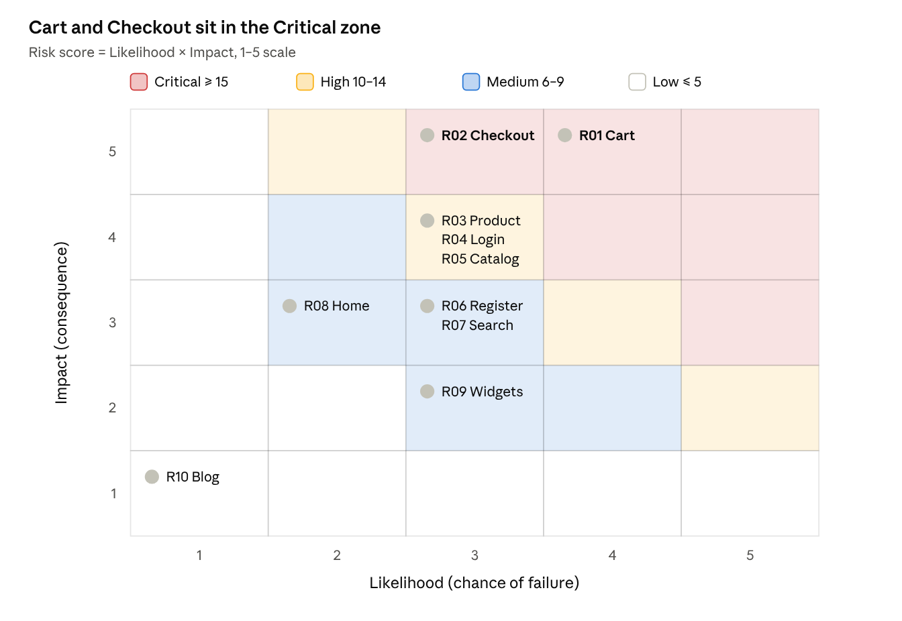
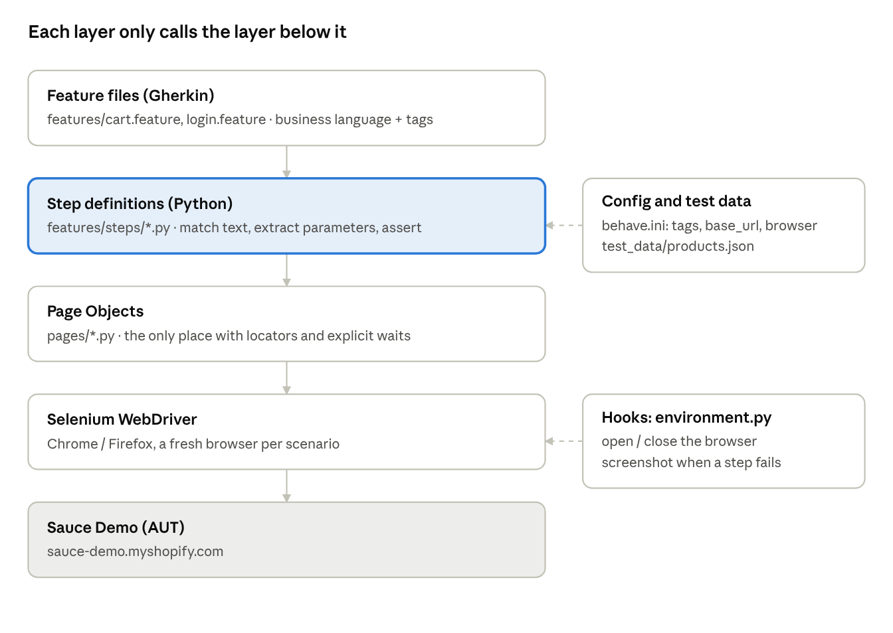

# Unit 1 – BDD Automation Design and Framework Practices (Sauce Demo)

behave (Cucumber for Python) + Selenium WebDriver · Application under test: https://sauce-demo.myshopify.com · Code: this repository

Unit 1 goes from risk analysis to a reviewed, runnable BDD framework: Day 1 decides what to automate, Day 2 builds the framework, Day 3 completes the executable specifications with traceable reports, Day 4 reviews and improves it.

| Day | Content | LO | Delivery | Minutes | Format |
| --- | --- | --- | --- | --- | --- |
| Day 1 | Risk-based automation strategy, testability analysis, BDD principles | LO1 | Concept/Lecture | 120 | Virtual |
| Day 2 | Cucumber/SpecFlow architecture, feature design, step definitions, hooks, tags, reporting patterns | LO2 | Concept/Lecture | 120 | Virtual |
| Day 3 | BDD implementation lab: executable specifications, reusable steps, hooks, tags, traceable reports | LO2 | Assignment/Lab | 150 | Hybrid |
| Day 4 | BDD framework review: maintainability, traceability, duplication, improvement actions | LO1, LO2 | Guides/Review | 60 | Hybrid |

Contents: Day 1 – Strategy · Day 2 – Architecture · Day 3 – Lab · Day 4 – Review

---

## Day 1 – Risk-based Automation Strategy, Testability & BDD Principles

Unit 1 · LO1 · Concept/Lecture · 120 min · Virtual

> Note: the sample features in section 6 are the final, executable files from `tests/features/` (checkout.feature and register.feature were added on Day 3). Section 7 shows the plan for Day 2–4 and marks what Day 3 added.

The Day 1 deliverable selects the five highest-risk business flows of Sauce Demo for automation first (cart, product, login, registration, search), specifies them in Gherkin, and sets up Python + behave + Selenium WebDriver as the base for Day 2–4 (Playwright is reserved for Unit 2, from Day 5).

### 0. Assignment information

| Item                         | Detail                                                                                                                           |
|------------------------------|----------------------------------------------------------------------------------------------------------------------------------|
| Unit                         | Unit 1 – BDD Automation Design and Framework Practices                                                                           |
| Day / LO                     | Day 1 · LO1 (Concept/Lecture, 120 min)                                                                                           |
| Topic                        | Risk-based automation strategy, testability analysis, BDD principles                                                             |
| AUT (Application Under Test) | [Sauce Demo](https://sauce-demo.myshopify.com/) – a Shopify demo store, prices in GBP (£)                                        |
| Proposed stack               | Python 3.11+, behave (Cucumber for Python), Selenium WebDriver 4 (Chrome/Firefox), Allure or behave-html-formatter for reporting |
| Day 1 outputs                | Risk-based automation strategy, testability analysis, sample requirements + Gherkin, initial traceability matrix                 |

Why behave: the course requires Cucumber or SpecFlow; behave is the closest Cucumber equivalent in Python (Gherkin feature files, step definitions, hooks in `environment.py`, tags). pytest-bdd is an alternative if the class prefers running inside pytest.

### 1. System overview and feature inventory

Sauce Demo has 10 functional areas; the catalog currently holds 7 products, 2 of them sold out (Brown Shades, White sandals), and the home page shows 3 featured products (surveyed on 3 Nov 2026).

| ID  | Feature             | URL / location                                      | Observed behaviour                                                                          |
|-----|---------------------|-----------------------------------------------------|---------------------------------------------------------------------------------------------|
| F01 | Home page           | `/`                                                 | Logo, menu, 3 featured products: Grey jacket £55.00, Noir jacket £60.00, Striped top £50.00 |
| F02 | Catalog             | `/collections/all`                                  | 7 products, GBP prices, "Sold Out" label on unavailable items                               |
| F03 | Product detail      | `/products/<handle>`                                | Name, price, image, description, add-to-cart, "You Might Also Like"                         |
| F04 | Cart                | `/cart`, mini-cart "My Cart (n)" in header          | Add / change quantity / remove, total, Check Out button                                     |
| F05 | Checkout            | From `/cart` to the Shopify-hosted checkout         | Address, shipping, payment                                                                  |
| F06 | Login               | `/account/login`                                    | Email Address, Password, "Forgot your password?" opens the Reset Password form              |
| F07 | Registration        | `/account/register`                                 | Create a customer account                                                                   |
| F08 | Search              | `/search`                                           | Search products by keyword                                                                  |
| F09 | Static content      | `/blogs/news`, `/pages/about-us`                    | Blog, About Us                                                                              |
| F10 | Third-party widgets | `#sauce-show-wish-list`, `#sauce-show-refer-friend` | Wish list, Refer a friend (Sauce app), social links                                         |

Product data used as test data:

| Product        | Price  | Status   | URL handle           |
|----------------|--------|----------|----------------------|
| Black heels    | £45.00 | In stock | `flower-print-jeans` |
| Bronze sandals | £39.99 | In stock | `bronze-sandals`     |
| Brown Shades   | £20.00 | Sold Out | `brown-shades`       |
| Grey jacket    | £55.00 | In stock | `grey-jacket`        |
| Noir jacket    | £60.00 | In stock | `noir-jacket`        |
| Striped top    | £50.00 | In stock | `striped-top`        |
| White sandals  | £25.00 | Sold Out | `white-sandals`      |

Note: the handle for Black heels is `flower-print-jeans`, which does not match its name — tests must not derive URLs from product names (see Testability).

### 2. Risk assessment

Cart (score 20) and Checkout (score 15) are the two Critical risks; they are automated first, while static content (score 1) stays manual.

Scoring: **Risk score = Likelihood × Impact**, each on a 1–5 scale.

| Level | Likelihood (chance of failure)                      | Impact (consequence of failure)            |
|-------|-----------------------------------------------------|--------------------------------------------|
| 1     | Rarely changes, static logic                        | No effect on purchasing                    |
| 3     | Changes occasionally, has logic/JS                  | Annoying, workaround exists                |
| 5     | Complex logic, many variants, external dependencies | Lost revenue, wrong amounts, data exposure |

Priority thresholds: Critical ≥ 15 · High 10–14 · Medium 6–9 · Low ≤ 5.

| Risk ID | Feature                 | Specific risk                                                         | L   | I   | Score | Level    |
|---------|-------------------------|-----------------------------------------------------------------------|-----|-----|-------|----------|
| R01     | F04 Cart                | Wrong product or quantity added, wrong total, mini-cart not updated   | 4   | 5   | 20    | Critical |
| R02     | F05 Checkout            | Cannot proceed to checkout, cart lost between pages                   | 3   | 5   | 15    | Critical |
| R03     | F03 Product detail      | Wrong price; sold-out product can still be bought                     | 3   | 4   | 12    | High     |
| R04     | F06 Login               | Invalid login accepted; no error shown; password reset broken         | 3   | 4   | 12    | High     |
| R05     | F02 Catalog             | Missing products, wrong prices, wrong Sold Out label                  | 3   | 4   | 12    | High     |
| R06     | F07 Registration        | No email/password validation, duplicate accounts                      | 3   | 3   | 9     | Medium   |
| R07     | F08 Search              | Real products not found; empty or special-character input not handled | 3   | 3   | 9     | Medium   |
| R08     | F01 Home & menu         | Broken menu links, wrong featured products                            | 2   | 3   | 6     | Medium   |
| R09     | F10 Third-party widgets | Wish list / Refer a friend do not open                                | 3   | 2   | 6     | Medium   |
| R10     | F09 Blog, About Us      | Wrong static content                                                  | 1   | 1   | 1     | Low      |



risk heat map · 10 risks by Likelihood × Impact

The two risks in the top-right (R01, R02) define the `@smoke` suite; the R03–R05 cluster on the Impact 4 row comes next.

### 3. Risk-based automation strategy

Automate in order of risk score: Critical and High go into `@smoke`/`@regression` in the first sprint; Medium joins `@regression` later; Low and anything outside our control stays manual.

#### 3.1 Automation decisions

| Risk ID                 | Decision                    | Automation scope                                                                     | Rationale                                                     |
|-------------------------|-----------------------------|--------------------------------------------------------------------------------------|---------------------------------------------------------------|
| R01 Cart                | Automate – P1, `@smoke`     | Add one and several products, change quantity, remove, verify total, mini-cart count | Highest risk, run often, deterministic results                |
| R02 Checkout            | Partially automate – P1     | Only up to the checkout page showing the right products and total                    | No real payments on the demo store; payment is Shopify-hosted |
| R03 Product detail      | Automate – P1               | Price, name, sold-out product cannot be added                                        | Wrong prices cause direct loss                                |
| R04 Login               | Automate – P1               | Wrong password, malformed email, empty fields, open reset form                       | Security flow; negative cases need no real account            |
| R05 Catalog             | Automate – P1               | All 7 products, prices, Sold Out labels (data-driven Scenario Outline)               | Stable data, easy table comparison                            |
| R06 Registration        | Conditionally automate – P2 | Validation errors; account creation with a random email, tagged `@data-creating`     | Creates real data on the store, must be controlled            |
| R07 Search              | Automate – P2               | Keyword with results, no results, empty keyword                                      | Cheap, stable                                                 |
| R08 Home & menu         | Automate – P3               | Menu links open the right pages                                                      | Cheap; doubles as an environment health check                 |
| R09 Third-party widgets | Manual                      | –                                                                                    | External app, flaky, not owned by the AUT                     |
| R10 Blog, About         | Manual / exploratory        | –                                                                                    | Low value, static content                                     |

#### 3.2 Test layering

Sauce Demo is a Shopify store: the team has no source code or internal API, so the test pyramid is skewed toward the UI. We compensate with quick HTTP checks (status 200 for key pages) at the lower layer, BDD end-to-end UI tests only for business flows, and manual/exploratory testing for the rest.

#### 3.3 Tagging scheme

| Tag                               | Meaning                                               | When it runs                |
|-----------------------------------|-------------------------------------------------------|-----------------------------|
| `@smoke`                          | Minimum flow: home opens, add to cart, reach checkout | Every deploy, \< 5 min      |
| `@regression`                     | All automated scenarios                               | Nightly                     |
| `@critical` / `@high` / `@medium` | Risk level from section 2                             | Filter when time is limited |
| `@R01` … `@R10`                   | Risk ID, for traceability                             | Coverage reporting          |
| `@negative`                       | Negative case                                         | –                           |
| `@data-creating`                  | Creates real data on the store                        | Only when permitted         |
| `@wip`, `@manual`                 | Work in progress / manual only                        | Excluded from the pipeline  |

#### 3.4 Entry and exit criteria

- Entry: the home page responds, the catalog holds the test data in section 1, Python 3.11+ and Chromium are available.

- Exit: 100% of `@critical` scenarios pass, ≥ 95% of `@regression` pass, every failure has a screenshot and is classified (product defect or script defect).

- Metrics: requirements with scenarios / total requirements, pass rate, flaky rate (fails then passes on rerun), smoke suite duration.

### 4. Testability analysis

Sauce Demo has medium testability: product data is stable and URLs are clear, but there are no test IDs, no dedicated environment, and checkout/payment is outside our control.

| Aspect                             | Rating      | Observation                                                                                       | Framework response                                                                                                          |
|------------------------------------|-------------|---------------------------------------------------------------------------------------------------|-----------------------------------------------------------------------------------------------------------------------------|
| Controllability – setting up state | Medium      | No API to reset the cart; cart is stored in cookies                                               | Each scenario runs in a fresh browser context (clean cookies) via the `before_scenario` hook                                |
| Observability – reading results    | Good        | Price, product name, "My Cart (n)", Sold Out label are all visible text                           | Assert on visible text; screenshot on failure in `after_step`                                                               |
| Locators                           | Medium–weak | Old theme, no `data-testid`; standard Shopify names/classes may exist (e.g. the `/cart/add` form) | Prefer standard Shopify text/name locators (`By.LINK_TEXT`, `By.NAME`), then stable attributes; keep them in Page Objects   |
| Test data                          | Good        | 7 products, fixed prices, 2 sold out                                                              | Keep in `dataset/products.json`, never hard-coded in steps                                                                |
| URL identity                       | Trap        | Black heels handle is `flower-print-jeans`                                                        | Map name → handle in test data; never derive URLs from names                                                                |
| Environment                        | Weak        | Only a shared production demo, no staging                                                         | No load testing; limit parallelism; tag account-creating cases `@data-creating`                                             |
| External dependencies              | Weak        | Checkout and payment hosted by Shopify; Sauce widgets, social links                               | Stop at the checkout page; do not automate widgets; blocking third-party requests is left to Playwright in Unit 2 (Day 6–7) |
| Synchronisation (timing)           | Medium      | Mini-cart updates via JS after add-to-cart                                                        | Use Selenium explicit waits `WebDriverWait(...).until(...)`, never `sleep`                                                  |
| Test accounts                      | Weak        | No account provided                                                                               | Negative cases need none; positive cases create an account with a random email stored in environment variables              |
| Bot protection                     | Risk        | Shopify may enable captcha on login/registration after many submissions                           | Limit runs; never bypass captcha; mark `@manual` if blocked                                                                 |

Open questions for the trainer: may the class create real accounts on this store, and is Allure required or are HTML/JSON reports enough?

### 5. BDD principles applied to Sauce Demo

BDD means agreeing on behaviour through concrete examples before writing code; Gherkin records those examples, and automation comes afterwards.

#### 5.1 The three BDD practices

1.  **Discovery** – the Three Amigos (BA/PO, Dev, QA) discuss a user story using Example Mapping: yellow card = story, blue = rule, green = example, red = open question.

2.  **Formulation** – turn the examples into Gherkin scenarios in business language.

3.  **Automation** – bind each step to code (behave step definitions) and run them as living documentation.

Example Mapping for the Cart story:

| Rule (blue)                                         | Example (green)                       | Question (red)                      |
|-----------------------------------------------------|---------------------------------------|-------------------------------------|
| Adding an in-stock product increments the mini-cart | Add Grey jacket → My Cart (1)         | –                                   |
| Total = price × quantity                            | 2 × Noir jacket → £120.00             | Is shipping shown on the cart page? |
| Sold-out products cannot be added                   | Brown Shades → no usable buy button   | Is the button hidden or disabled?   |
| Removing the product empties the cart               | Remove Striped top → cart shows empty | –                                   |

#### 5.2 Gherkin writing rules

- Declarative, not imperative: describe *what* happens, not where to click.

- One scenario checks one behaviour; about 5–7 steps at most.

- Given = state, When = one action, Then = observable outcome.

- Use the user's language (product, cart), never locators, URLs or CSS.

- Varying data → `Scenario Outline` + `Examples`; shared setup → `Background`.

- Every scenario is independent of run order.

- Tag risk and requirement IDs for traceability.

#### 5.3 Bad vs good example

Bad (imperative, tied to the UI):

```gherkin
Scenario: add to cart
  Given I open "https://sauce-demo.myshopify.com/collections/all"
  When I click on "a[href*='grey-jacket']"
  And I click the button with id "add"
  And I wait 3 seconds
  Then the element "#cart-count" should contain "1"
```

Good (declarative, business-focused):

```gherkin
@R01 @critical @smoke
Scenario: Customer adds an in-stock product to the cart
  Given the customer is viewing the product "Grey jacket"
  When the customer adds the product to the cart
  Then the cart should contain 1 item
  And the cart total should be "£55.00"
```

### 6. Sample requirements and Gherkin

The eight requirements below cover every Critical, High and Medium risk chosen for automation; each has acceptance criteria (AC) that map directly to scenarios.

| REQ    | User story                                                              | Acceptance criteria                                                                                       | Risk |
|--------|-------------------------------------------------------------------------|-----------------------------------------------------------------------------------------------------------|------|
| REQ-01 | As a customer, I want to add products to my cart so that I can buy them | AC1 adding an in-stock product increments the mini-cart by 1; AC2 total = price × quantity                | R01  |
| REQ-02 | As a customer, I want to edit or remove products in my cart             | AC1 changing quantity updates the total; AC2 removing all items shows an empty cart                       | R01  |
| REQ-03 | As a customer, I want to proceed to checkout                            | AC1 Check Out from a non-empty cart opens checkout with the right products                                | R02  |
| REQ-04 | As a customer, I want to see correct product information                | AC1 name and price match the catalog; AC2 a sold-out product cannot be added to the cart                  | R03  |
| REQ-05 | As a customer, I want to log in securely                                | AC1 invalid credentials show an error and do not log in; AC2 "Forgot your password?" opens the reset form | R04  |
| REQ-06 | As a customer, I want to browse the product list                        | AC1 catalog shows all 7 products with correct prices; AC2 sold-out products carry a Sold Out label        | R05  |
| REQ-07 | As a new customer, I want to create an account                          | AC1 missing required fields show an error; AC2 valid data creates an account                              | R06  |
| REQ-08 | As a customer, I want to search products by keyword                     | AC1 "jacket" returns Grey jacket and Noir jacket; AC2 an unknown keyword shows no results                 | R07  |

#### 6.1 Sample feature – Cart (`tests/features/cart.feature`)

```gherkin
@cart @R01
Feature: Shopping cart
  As a customer
  I want to manage products in my cart
  So that I can buy what I need

  @critical @smoke
  Scenario: Add an in-stock product to the cart
    Given the customer is viewing the product "Grey jacket"
    When the customer adds the product to the cart
    Then the cart should contain 1 item
    And the cart total should be "£55.00"

  @critical @regression
  Scenario Outline: Cart total equals price times quantity
    Given the customer has <quantity> of "<product>" in the cart
    When the customer opens the cart
    Then the cart should contain <quantity> items
    And the cart total should be "<total>"

    Examples:
      | product     | quantity | total   |
      | Noir jacket | 2        | £120.00 |
      | Striped top | 3        | £150.00 |

  @critical @regression
  Scenario: Change the quantity of a product in the cart
    Given the customer has 1 of "Bronze sandals" in the cart
    When the customer changes the quantity of "Bronze sandals" to 2
    Then the cart should contain 2 items
    And the cart total should be "£79.98"

  @critical @regression
  Scenario: Remove the only product from the cart
    Given the customer has 1 of "Striped top" in the cart
    When the customer removes "Striped top" from the cart
    Then the cart should be empty
```

#### 6.2 Sample feature – Product and catalog (`tests/features/product.feature`)

```gherkin
@product
Feature: Product information
  As a customer
  I want correct product names, prices and stock status
  So that I know what I am buying

  @R05 @high @regression
  Scenario Outline: Catalog shows correct price and stock status
    When the customer browses the full catalog
    Then the product "<product>" should be listed at its catalog price
    And the product "<product>" should be shown as "<status>"

    Examples:
      | product        | status    |
      | Black heels    | available |
      | Bronze sandals | available |
      | Brown Shades   | sold out  |
      | Grey jacket    | available |
      | Noir jacket    | available |
      | Striped top    | available |
      | White sandals  | sold out  |

  @R03 @high @regression
  Scenario: Product page shows the catalog name and price
    Given the customer is viewing the product "Noir jacket"
    Then the product page should show the name "Noir jacket"
    And the product page should show the price "£60.00"

  @R03 @high @negative @regression
  Scenario: A sold-out product cannot be added to the cart
    Given the customer is viewing the product "Brown Shades"
    Then the customer should not be able to add it to the cart
```

#### 6.3 Sample feature – Login (`tests/features/login.feature`)

```gherkin
@login @R04
Feature: Customer login
  As a customer
  I want only valid credentials to log me in
  So that my account stays safe

  Background:
    Given the customer is on the login page

  @high @negative @regression
  Scenario Outline: Login is rejected with invalid credentials
    When the customer logs in with email "<email>" and password "<password>"
    Then a login error should be shown
    And the customer should not be logged in

    Examples:
      | email                  | password   |
      | not-a-user@example.com | wrongpass1 |
      | not-an-email           | wrongpass1 |

  @high @regression
  Scenario: Customer opens the password reset form
    When the customer chooses to reset the password
    Then the password reset form should be shown
```

#### 6.4 Sample feature – Search (`tests/features/search.feature`)

```gherkin
@search @R07 @medium
Feature: Product search
  As a customer
  I want to find products by keyword
  So that I do not have to browse the whole catalog

  @regression
  Scenario: Search returns matching products
    Given the customer is on the home page
    When the customer searches for "jacket"
    Then the results should include "Grey jacket"
    And the results should include "Noir jacket"

  @negative @regression
  Scenario: Search with no matching products
    Given the customer is on the home page
    When the customer searches for "zzqxnotaproduct"
    Then no products should be shown in the results
```

Reusable steps (e.g. `the customer is viewing the product "..."`, `the cart total should be "..."`) form the step template set for Day 2–3.

### 7. Traceability, next steps and rubric

6 of 8 requirements have Gherkin scenarios in section 6; REQ-03 (checkout) and REQ-07 (registration) are specified on Day 3 in `checkout.feature` and `register.feature`.

#### 7.1 Initial traceability matrix

| REQ | Risk | Level | Feature file | Scenario | Status |
| --- | --- | --- | --- | --- | --- |
| REQ-01 | R01 | Critical | cart.feature | Add an in-stock product; Cart total equals price times quantity | Specified |
| REQ-02 | R01 | Critical | cart.feature | Change the quantity; Remove the only product from the cart | Specified |
| REQ-03 | R02 | Critical | checkout.feature | Checkout opens from a non-empty cart | Added on Day 3 |
| REQ-04 | R03 | High | product.feature | Product page shows the catalog name and price; A sold-out product cannot be added | Specified |
| REQ-05 | R04 | High | login.feature | Login is rejected with invalid credentials; Customer opens the password reset form | Specified |
| REQ-06 | R05 | High | product.feature | Catalog shows correct price and stock status | Specified |
| REQ-07 | R06 | Medium | register.feature | Registration is rejected without an email; Registration succeeds (`@data-creating`) | Added on Day 3 |
| REQ-08 | R07 | Medium | search.feature | Search returns matching products; Search with no matching products | Specified |

Traceability goes through tags: every scenario carries a risk tag `@Rxx`, and `dataset/requirements.json` maps each requirement to its risk, so `behave --dry-run --tags=@R01` lists the scenarios behind REQ-01 and REQ-02.

#### 7.2 Planned Python project structure (built on Day 2)

```text
sauce-demo-unit1-bdd/
├── pages/                # Page Objects: home, catalog, product, cart, login, search
├── tests/
│   ├── features/         # cart.feature, product.feature, login.feature, search.feature, ...
│   ├── steps/            # reusable step definitions
│   └── environment.py    # hooks: before_all, before_scenario, after_step, after_scenario
├── dataset/products.json # test data (Unit 2 keeps a copy in its dataset/)
├── reports/              # HTML/JSON/Allure + failure screenshots
├── behave.ini
└── requirements.txt      # behave, selenium, behave-html-formatter, allure-behave
```

#### 7.3 Day 2–4 plan

| Day   | Work                                                                                                                             | Output                                            |
|-------|----------------------------------------------------------------------------------------------------------------------------------|---------------------------------------------------|
| Day 2 | Set up behave + Selenium, Page Objects, step definitions, hooks, tags                                                            | `behave --dry-run` passes with no undefined steps |
| Day 3 | Lab: complete scenarios for REQ-01 → REQ-08, screenshots on failure, HTML/Allure report, traceability matrix generated from tags | Repo + real run report                            |
| Day 4 | Review against the rubric below, find duplicate steps, propose improvements                                                      | Review sheet + action list                        |

#### 7.4 Self-review rubric (reused on Day 4)

| Criterion                | Met when                                                                         | Self-score (0–2) |
|--------------------------|----------------------------------------------------------------------------------|------------------|
| Risk drives scope        | Every Critical/High risk has a scenario; reasons for not automating are recorded |                  |
| Declarative Gherkin      | No locators, URLs or `wait` in feature files                                     |                  |
| Independence             | Each scenario runs on its own, regardless of order                               |                  |
| Step reuse               | No two steps with the same meaning but different wording                         |                  |
| Traceability             | Every scenario has a risk tag `@Rxx`                                                  |                  |
| Data separated from code | Prices, names, handles live in test data / Examples                              |                  |
| Reporting                | HTML/JSON report, screenshots on failure                                         |                  |
| Stability                | No `sleep`; three consecutive runs give the same result                          |                  |

---

## Day 2 – Cucumber (behave) Architecture: Features, Step Definitions, Hooks, Tags & Reporting

Unit 1 · LO2 · Concept/Lecture · 120 min · Virtual

Day 2 turns the Day 1 Gherkin specs into a runnable behave + Selenium framework: 2 features (cart, login), 8 scenarios, the step definitions they use, 4 hooks, a tagging scheme and 3 report types. The Unit 1 code is this repository; Day 2 explains the architecture through `cart.feature` and `login.feature`.

### 0. Assignment information

| Item             | Detail                                                                                                                                                              |
|------------------|---------------------------------------------------------------------------------------------------------------------------------------------------------------------|
| Unit             | Unit 1 – BDD Automation Design and Framework Practices                                                                                                              |
| Day / LO         | Day 2 · LO2 (Concept/Lecture, 120 min, Virtual)                                                                                                                     |
| Topic            | Cucumber/SpecFlow architecture, feature design, step definitions, hooks, tags, reporting patterns                                                                   |
| AUT              | [Sauce Demo](https://sauce-demo.myshopify.com/)                                                                                                                     |
| Stack            | Python 3.11+, behave 1.3 (Cucumber for Python), Selenium WebDriver 4, behave-html-formatter, allure-behave                                                          |
| Input from Day 1 | Risk register, REQ-01…REQ-08, draft features tagged with risks `@Rxx`                                                                                              |
| Day 2 output     | A runnable starter framework; `behave --dry-run` reports no undefined steps; cart + login run for real                                                              |
| Scope            | REQ-01, REQ-02 (cart, R01 Critical) and REQ-05 (login, R04 High) – the two highest risks that can be fully automated. The remaining requirements are done on Day 3. |

Playwright is not used in Unit 1; Unit 2 (from Day 5) moves to Playwright.

### 1. Cucumber / behave architecture

The framework has 4 layers and each layer only knows the one below it: feature files (business) → step definitions (glue) → Page Objects (UI) → Selenium WebDriver (browser). Hooks and configuration wrap the whole run.

| Layer            | File in the repo               | Responsibility                                                    | Must not contain         |
|------------------|-----------------------------------------|-------------------------------------------------------------------|--------------------------|
| Feature          | `tests/features/*.feature`                    | Behaviour in business language, tags                              | Locators, URLs, waits    |
| Step definitions | `tests/steps/*.py`                   | Match Gherkin text, extract parameters, call Page Objects, assert | Locators, `find_element` |
| Page Object      | `pages/*.py`                            | Locators and actions per page, explicit waits                     | Business assertions      |
| Driver           | Selenium WebDriver                      | Drives Chrome/Firefox                                             | –                        |
| Hooks            | `tests/environment.py`               | Open/close the browser, skip tags, screenshot on failure          | Business logic           |
| Config / data    | `behave.ini`, `dataset/products.json` | Default tags, base_url, browser; product names, handles, prices   | –                        |

Folder structure:

```text
sauce-demo-unit1-bdd/
├── behave.ini                 # config: default tags, userdata, formatters
├── requirements.txt           # behave, selenium, behave-html-formatter, allure-behave
├── pages/                     # BasePage, ProductPage, CartPage, CatalogPage, LoginPage
├── tests/                     # behave.ini: paths = tests
│   ├── features/
│   │   ├── cart.feature       # REQ-01, REQ-02
│   │   └── login.feature      # REQ-05
│   ├── steps/
│   │   ├── common_steps.py    # shared navigation
│   │   ├── cart_steps.py
│   │   └── account_steps.py
│   └── environment.py         # hooks
├── helper_utility/helpers.py  # page(), product(): helpers shared by steps
├── dataset/products.json      # test data (Unit 2 keeps a copy in its dataset/)
└── reports/
```

Why `helper_utility/helpers.py` lives outside `tests/steps/`: behave loads every file in `steps/` itself; if one step file imports another, its `@given/@when/@then` decorators run twice and behave raises `AmbiguousStep`.



sauce-demo-unit1-bdd architecture · 5 layers + hooks + config

When the theme's UI changes, only the Page Object layer is edited; features and steps stay the same.

### 2. Feature file design

Each feature file covers one business capability; Feature-level tags apply to every scenario below, Scenario-level tags only to that scenario.

| Keyword                             | Use it when                                    | Example in code                           |
|-------------------------------------|------------------------------------------------|-------------------------------------------|
| `Feature` + As a / I want / So that | Grouping the scenarios of one capability       | `Feature: Shopping cart`                  |
| `Background`                        | A Given repeated in every scenario of the file | `Given the customer is on the login page` |
| `Scenario`                          | One concrete example                           | Add an in-stock product to the cart       |
| `Scenario Outline` + `Examples`     | Same behaviour, several data sets              | 2 × Noir jacket, 3 × Striped top          |
| `@tag`                              | Classifying for filtering and traceability     | `@R01 @critical @smoke`                |

`tests/features/cart.feature`:

```gherkin
@cart @R01
Feature: Shopping cart
  As a customer
  I want to manage products in my cart
  So that I can buy what I need

  @critical @smoke
  Scenario: Add an in-stock product to the cart
    Given the customer is viewing the product "Grey jacket"
    When the customer adds the product to the cart
    Then the cart should contain 1 item
    And the cart total should be "£55.00"

  @critical @regression
  Scenario Outline: Cart total equals price times quantity
    Given the customer has <quantity> of "<product>" in the cart
    When the customer opens the cart
    Then the cart should contain <quantity> items
    And the cart total should be "<total>"

    Examples:
      | product     | quantity | total   |
      | Noir jacket | 2        | £120.00 |
      | Striped top | 3        | £150.00 |

  @critical @regression
  Scenario: Change the quantity of a product in the cart
    Given the customer has 1 of "Bronze sandals" in the cart
    When the customer changes the quantity of "Bronze sandals" to 2
    Then the cart should contain 2 items
    And the cart total should be "£79.98"

  @critical @regression
  Scenario: Remove the only product from the cart
    Given the customer has 1 of "Striped top" in the cart
    When the customer removes "Striped top" from the cart
    Then the cart should be empty
```

`tests/features/login.feature` (shows `Background` and negative cases):

```gherkin
@login @R04
Feature: Customer login
  As a customer
  I want only valid credentials to log me in
  So that my account stays safe

  Background:
    Given the customer is on the login page

  @high @negative @regression
  Scenario Outline: Login is rejected with invalid credentials
    When the customer logs in with email "<email>" and password "<password>"
    Then a login error should be shown
    And the customer should not be logged in

    Examples:
      | email                  | password   |
      | not-a-user@example.com | wrongpass1 |
      | not-an-email           | wrongpass1 |

  @high @regression
  Scenario: Customer opens the password reset form
    When the customer chooses to reset the password
    Then the password reset form should be shown
```

Rules applied: Given = state, When = one action, Then = observable outcome; no URLs, CSS or waits in features; at most 7 steps per scenario.

### 3. Step definitions

Each Gherkin line matches exactly one Python function through `@given / @when / @then`; behave matches the full sentence (Given/And keywords are interchangeable), so a step written once is reused across features.

#### 3.1 Parameters (default parse matcher)

| Syntax               | Matches         | Value in the function                          |
|----------------------|-----------------|------------------------------------------------|
| `"{name}"`           | `"Grey jacket"` | `name = "Grey jacket"` (str)                   |
| `{quantity:d}`       | `2`             | `quantity = 2` (int)                           |
| `"{expected}"`       | `"£55.00"`      | string, converted with `money_to_float()`      |
| `re` matcher (Day 4) | `items?`        | regex when singular/plural variants are needed |

#### 3.2 Code: `tests/steps/cart_steps.py`

```python
"""Cart steps (REQ-01, REQ-02)."""
from behave import given, then, when

from pages import CartPage, ProductPage, money_to_float
from helper_utility.helpers import page, product


@given('the customer has {quantity:d} of "{name}" in the cart')
def step_has_in_cart(context, quantity, name):
    product_page = page(context, ProductPage)
    product_page.open_product(product(context, name)["handle"])
    product_page.add_to_cart(quantity)


@when("the customer adds the product to the cart")
def step_add_current(context):
    page(context, ProductPage).add_to_cart(1)


@when('the customer changes the quantity of "{name}" to {quantity:d}')
def step_change_qty(context, name, quantity):
    cart = page(context, CartPage).open()
    cart.set_quantity(name, quantity)


# Day 4 (finding F1) merged "item"/"items" into one regex step:
use_step_matcher("re")


@then(r"the cart should contain (?P<count>\d+) items?")
def step_cart_count(context, count):
    count = int(count)
    cart = page(context, CartPage).open()
    actual = cart.total_quantity()
    assert actual == count, f"Expected {count} item(s) in the cart, found {actual}"
    assert cart.mini_cart_count() == count, f"Mini-cart shows {cart.mini_cart_count()}, expected {count}"


@then('the cart total should be "{expected}"')
def step_cart_total(context, expected):
    cart = page(context, CartPage).open()
    actual = cart.total()
    assert actual == money_to_float(expected), f"Expected total {expected}, found £{actual:.2f}"
```

#### 3.3 Shared helpers: `helper_utility/helpers.py`

```python
def product(context, name):
    """Look up test data by product name; fail loudly on an unknown name."""
    try:
        return context.products[name]
    except KeyError:
        raise AssertionError(f"Unknown product {name!r}: add it to dataset/products.json")


def page(context, cls):
    """Build a Page Object bound to this scenario's browser."""
    return cls(context.driver, context.base_url, context.timeout)
```

#### 3.4 The Page Object the steps call (`pages/product_page.py`, shortened)

```python
ADD_FORM = "form[action*='/cart/add']"            # standard Shopify add-to-cart form
ADD_BUTTON = ADD_FORM + " [type='submit']"


class ProductPage(BasePage):
    def open_product(self, handle: str):
        return self.open(f"/products/{handle}")

    def add_to_cart(self, quantity: int = 1):
        qty = self.find_all(By.CSS_SELECTOR, ADD_FORM + " input[name='quantity']")
        if qty:
            qty[0].clear()
            qty[0].send_keys(str(quantity))
            self._submit()
        else:  # theme without a quantity box: add the product N times
            ...

    def _submit(self):
        self.submit(By.CSS_SELECTOR, ADD_BUTTON)   # BasePage.submit: click + wait for the new page
        self.wait.until(lambda d: "/cart" in d.current_url and "/products/" not in d.current_url)


# pages/base_page.py – used by every form button (Add to Cart, Update, Check Out, Sign In)
def submit(self, by, value):
    old_page = self.driver.find_element(By.TAG_NAME, "html")
    self.click(by, value)
    self.wait.until(EC.staleness_of(old_page))     # explicit wait, never time.sleep
```

Step-writing rules:

- No locators in steps; every locator lives in `pages/`.

- Data (handles, prices) comes from `dataset/products.json`, never hard-coded.

- Every assert says what was expected and what was found, so reports are readable.

- State shared between steps lives on `context` (e.g. `context.driver`), never in globals.

- `behave --dry-run` prints snippets for undefined steps – the fastest way to see what is missing.

### 4. Hooks

Hooks live in `tests/environment.py` and handle all setup and teardown, so features and steps only talk about the business. The Day 2 framework uses 4 hooks.

The order in which behave calls hooks during one run:

1.  `before_all` – once at the start.

2.  `before_feature` – per feature (not used on Day 2).

3.  `before_tag` – per scenario tag (not used on Day 2).

4.  `before_scenario` – per scenario, including every Examples row.

5.  `before_step` / `after_step` – around every step.

6.  `after_scenario`, `after_feature`, `after_all` – in reverse order.

| Hook              | What it does in this repo                                                                                     | Why                                                         |
|-------------------|----------------------------------------------------------------------------------------------------------------------|-------------------------------------------------------------|
| `before_all`      | Reads `base_url`, `browser`, `headless`, `timeout` from environment variables or `behave.ini`; loads `products.json` | One config source; change environment without touching code |
| `before_scenario` | Skips `@manual`/`@wip`; opens a fresh browser                                                                        | Clean cookies → empty cart → independent scenarios          |
| `after_step`      | Failed step → screenshot into `reports/screenshots/`, attached to Allure                                             | Evidence to classify product vs script defects              |
| `after_scenario`  | Quits the browser                                                                                                    | No leaked resources, no shared state                        |

Code: `tests/environment.py`

```python
import json
import os
import re
import sys
from pathlib import Path

from selenium import webdriver

ROOT = Path(__file__).resolve().parent.parent
sys.path.insert(0, str(ROOT))  # makes pages/ and helper_utility/ importable from steps
SCREENSHOTS = ROOT / "reports" / "screenshots"


def _make_driver(browser: str, headless: bool):
    if browser == "firefox":
        options = webdriver.FirefoxOptions()
        if headless:
            options.add_argument("-headless")
        return webdriver.Firefox(options=options)
    options = webdriver.ChromeOptions()
    if headless:
        options.add_argument("--headless=new")
    options.add_argument("--window-size=1366,900")
    return webdriver.Chrome(options=options)  # Selenium Manager downloads the matching driver


def before_all(context):
    userdata = context.config.userdata
    context.base_url = os.getenv("BASE_URL", userdata.get("base_url", "https://sauce-demo.myshopify.com"))
    context.browser_name = os.getenv("BROWSER", userdata.get("browser", "chrome"))
    context.headless = os.getenv("HEADLESS", userdata.get("headless", "true")).lower() == "true"
    context.timeout = int(userdata.get("timeout", "10"))
    with open(ROOT / "dataset" / "products.json", encoding="utf-8") as fh:
        context.products = json.load(fh)["products"]
    SCREENSHOTS.mkdir(parents=True, exist_ok=True)


def before_scenario(context, scenario):
    if {"manual", "wip"} & set(scenario.effective_tags):
        scenario.skip("Tagged @manual / @wip")
        return
    context.driver = _make_driver(context.browser_name, context.headless)
    context.driver.implicitly_wait(0)  # explicit waits only


def after_step(context, step):
    if step.status == "failed" and getattr(context, "driver", None):
        name = re.sub(r"[^\w-]+", "_", f"{context.scenario.name}_{step.name}")[:120]
        path = SCREENSHOTS / f"{name}.png"
        context.driver.save_screenshot(str(path))
        try:  # attach to the Allure report when allure-behave is the formatter
            import allure
            allure.attach.file(str(path), name="failure", attachment_type=allure.attachment_type.PNG)
        except Exception:
            pass


def after_scenario(context, scenario):
    driver = getattr(context, "driver", None)
    if driver:
        driver.quit()
        context.driver = None
```

The file in the zip adds a few lines for Docker/CI (`--no-sandbox`, `CHROMEDRIVER_PATH`); they are not needed on a personal machine.

### 5. Tags

Tags do three jobs: select which scenarios run, steer hooks (skip `@manual`), and link scenarios to requirements and risks for traceability.

| Group        | Tags                                | Used on Day 2                             |
|--------------|-------------------------------------|-------------------------------------------|
| Suite        | `@smoke`, `@regression`             | Add an in-stock product = `@smoke`        |
| Risk level   | `@critical`, `@high`, `@medium`     | Cart `@critical`, login `@high`           |
| Traceability | `@R01`…`@R10` | `@R01` (cart), `@R04` (login) |
| Case type    | `@negative`                         | Invalid login                             |
| Control      | `@manual`, `@wip`, `@data-creating` | Excluded by default                       |
| Capability   | `@cart`, `@login`                   | Feature-level tags                        |

Filter expressions (behave 1.3, tag expressions v2):

```bash
behave --tags=@smoke                                  # smoke only
behave --tags="@critical and not @negative"           # critical, no negative cases
behave --tags="@R01 or @R04"                          # by risk (several risks)
behave --tags=@R01                                    # by risk
behave --tags="@data-creating or not @data-creating"  # everything, overriding the default
```

`behave.ini` sets the default filter and configuration:

```ini
[behave]
paths = tests
# Default filter: never run manual, work-in-progress or data-creating scenarios.
tags = not @manual and not @wip and not @data-creating
show_skipped = false
default_format = pretty
junit = true
junit_directory = reports/junit

[behave.userdata]
base_url = https://sauce-demo.myshopify.com
browser = chrome
headless = true
timeout = 10

[behave.formatters]
html = behave_html_formatter:HTMLFormatter
```

`[behave.userdata]` can be overridden per run: `behave -D browser=firefox -D headless=false`, or through the `BASE_URL`, `BROWSER`, `HEADLESS` environment variables.

### 6. Reporting patterns

Each audience needs a different report, and behave can write several in one run.

| Formatter             | Command                                                                | Output                            | Audience                                |
|-----------------------|------------------------------------------------------------------------|-----------------------------------|-----------------------------------------|
| `pretty` / `progress` | `-f pretty`, `-f progress`                                             | Console                           | Whoever runs the tests                  |
| JSON                  | `-f json.pretty -o reports/results.json`                               | JSON file                         | Traceability script (Day 3), dashboards |
| HTML                  | `-f html -o reports/report.html`                                       | HTML page (behave-html-formatter) | Trainer, BA, PO                         |
| JUnit XML             | `junit = true` in `behave.ini`                                         | `reports/junit/*.xml`             | CI (Jenkins, GitHub Actions, GitLab)    |
| Allure                | `-f allure_behave.formatter:AllureFormatter -o reports/allure-results` | Allure results + attachments      | History and trends                      |
| Screenshots           | `after_step` hook                                                      | `reports/screenshots/*.png`       | Failure analysis                        |

Several formatters at once. behave pairs each `-o` with the `-f` just before it, so the console formatter must come last:

```bash
behave -f json.pretty -o reports/results.json \
       -f html -o reports/report.html \
       -f progress
```

Putting `-f progress` first writes progress output into `results.json` and JSON into `report.html` – a common mistake. Day 3 wraps this command in `run.py`.

View Allure with `allure serve reports/allure-results` (requires the Allure CLI).

### 7. Running, results and review

#### 7.1 How to run

```bash
cd sauce-demo-unit1-bdd
pip install -r requirements.txt
behave --dry-run                 # 1. is every step implemented? (no browser)
behave --tags=@smoke             # 2. smoke: 1 scenario
behave tests/features/cart.feature tests/features/login.feature   # 3. Day 2 scope: 8 scenarios
behave -D headless=false         # watch the browser
```

Requires Python 3.11+ and Chrome; Selenium Manager downloads chromedriver automatically.

#### 7.2 Expected results

| Check                                                  | Result                                                                |
|--------------------------------------------------------|-----------------------------------------------------------------------|
| `behave --dry-run`                                     | 0 undefined steps                                                     |
| `behave`                                               | 2 features, 8 scenarios, 30 steps passed                              |
| Step reuse | The `item`/`items` duplicate found in the Day 4 review is already merged into one regex step (finding F1) |

These numbers come from a run against a local Shopify-structured mock store. On the live Sauce Demo, if a step fails because of a locator, fix it only in `pages/`.

#### 7.3 Review questions

1.  Why must step definitions not contain locators?

2.  How does `Background` differ from the `before_scenario` hook, and when do you use each?

3.  Write a tag expression that runs only `@critical` scenarios that are not `@negative`.

4.  Explain why opening a fresh browser in `before_scenario` makes scenarios independent.

5.  The theme changes "Add to Cart" from an `input` to a `button`: what changes, and in which file?

#### 7.4 Bridge to Day 3

Day 3 keeps this architecture and adds `checkout.feature`, `product.feature`, `register.feature`, `search.feature` (completing REQ-01…REQ-08), `product_steps.py`, `search_steps.py`, and `run.py` (all reports in one command); traceability comes from the `@Rxx` risk tags.

---

## Day 3 – BDD Implementation Lab: Executable Specs, Reusable Steps, Hooks, Tags & Traceable Reports

Unit 1 · LO2 · Assignment/Lab · 150 min · Hybrid · Code: repo `sauce-demo-unit1-bdd` (behave + Selenium)

Day 3 completes the Day 2 framework: 6 feature files, 14 scenarios (22 runs with Examples) cover all 8 Unit 1 requirements, one command produces HTML/JSON/JUnit/Allure reports, and the `@Rxx` risk tags keep every scenario traceable.

### 1. What is added on top of Day 2

| Added | File | Purpose |
| --- | --- | --- |
| Checkout spec | `tests/features/checkout.feature` | REQ-03, R02 Critical, stops at the checkout page |
| Product and catalog spec | `tests/features/product.feature` | REQ-04, REQ-06: 7-row Examples table, sold-out case |
| Registration spec | `tests/features/register.feature` | REQ-07: negative case + `@data-creating` positive case |
| Search spec | `tests/features/search.feature` | REQ-08: results / no results |
| New steps | `tests/steps/product_steps.py`, `search_steps.py` | Catalog, detail page, search |
| One-command runner | `run.py` | Tests + all reports |
| Traceability | `@Rxx` risk tag on every scenario | `behave --dry-run --tags=@R02` lists the scenarios of a risk; `dataset/requirements.json` maps each requirement to its risk |
| Shared data | `dataset/products.json`, `dataset/requirements.json` | Same data and requirement list for Unit 1 and Unit 2 |

### 2. Executable specifications

| Feature file | Scenarios | REQ | Risk | Suite tags |
| --- | --- | --- | --- | --- |
| `cart.feature` | Add an in-stock product; Cart total = price × quantity (2 rows); Change quantity; Remove the only product | REQ-01, REQ-02 | R01 Critical | `@smoke` (add), `@regression` |
| `checkout.feature` | Checkout opens from a non-empty cart | REQ-03 | R02 Critical | `@smoke` |
| `product.feature` | Catalog price and stock (7 rows); Product page name and price; Sold-out cannot be added | REQ-04, REQ-06 | R03, R05 High | `@regression`, `@negative` |
| `login.feature` | Invalid credentials rejected (2 rows); Password reset form opens | REQ-05 | R04 High | `@negative`, `@regression` |
| `register.feature` | Rejected without email; Succeeds with valid details | REQ-07 | R06 Medium | `@negative`; `@data-creating` (excluded by default) |
| `search.feature` | Matching products; No matching products | REQ-08 | R07 Medium | `@regression`, `@negative` |

Example of a data-driven spec (`tests/features/product.feature`):

```gherkin
@R05 @high @regression
Scenario Outline: Catalog shows correct price and stock status
  When the customer browses the full catalog
  Then the product "<product>" should be listed at its catalog price
  And the product "<product>" should be shown as "<status>"

  Examples:
    | product        | status    |
    | Black heels    | available |
    | Brown Shades   | sold out  |
    | White sandals  | sold out  |
```

The price is not repeated in the feature: the step reads it from `dataset/products.json`, so a price change is edited in one place.

### 3. Reusable steps

| Step module | Used by | Example |
| --- | --- | --- |
| `common_steps.py` | every feature | `the customer is viewing the product "{name}"` |
| `cart_steps.py` | cart, checkout | `the customer has {quantity:d} of "{name}" in the cart` (also used as Given in checkout) |
| `product_steps.py` | product | `the product "{name}" should be listed at its catalog price` |
| `account_steps.py` | login, register | `a login error should be shown` |
| `search_steps.py` | search | `the results should include "{name}"` |

Every step calls a Page Object from `pages/`; no step contains a locator.

### 4. Hooks and tags in the lab

- `before_scenario`: fresh browser per scenario, skip `@manual` / `@wip`.
- `after_step`: screenshot on failure into `reports/screenshots/`, attached to Allure.
- `behave.ini`: default filter `not @manual and not @wip and not @data-creating`.

### 5. Run and reports

```bash
cd sauce-demo-unit1-bdd
pip install -r requirements.txt
python run.py                         # default suite
python run.py --tags=@smoke           # smoke only
python run.py --tags=@data-creating   # creates a real account: only with trainer approval
python run.py --allure                # also writes reports/allure-results
```

| Output | Path |
| --- | --- |
| HTML report | `reports/report.html` |
| JSON results | `reports/results.json` |
| JUnit XML (CI) | `reports/junit/*.xml` |
| Allure results | `reports/allure-results/` (`allure serve reports/allure-results`) |
| Screenshots of failed steps | `reports/screenshots/` |

### 6. Expected results

| Check | Result |
| --- | --- |
| `behave --dry-run` | 0 undefined steps |
| `python run.py` | 6 features, 21 scenarios passed, 1 skipped (`@data-creating`), 70 steps passed |
| Traceability | `behave --dry-run --tags=@R01` … `@R07`: every automated risk lists at least one scenario |

Verified against a local Shopify-structured mock of the store. On the live Sauce Demo, a locator mismatch is fixed only in `pages/`.

### 7. Lab exercises

1. Add a scenario for REQ-02: changing the quantity to 0 removes the line. Which existing steps can you reuse?
2. Add a scenario to `search.feature` that searches for "JACKET" (upper case). Does `behave --dry-run --tags=@R07` list it without code changes?
3. Break one price in `dataset/products.json`, run `python run.py`, and find the failure screenshot.

---

## Day 4 – BDD Framework Review: Maintainability, Traceability, Duplication & Improvement Actions

Unit 1 · LO1, LO2 · Guides/Review · 60 min · Hybrid · Code: repo `sauce-demo-unit1-bdd`

The Day 3 framework scores 15/16 on the review rubric after the fixes made during the review (F1 duplicate step, F5 duplicated requirement list) and the re-check with Unit 2 (F7, F8 form-submit races); the remaining open items need the live store or trainer input.

### 1. How the review is run

```bash
cd sauce-demo-unit1-bdd
behave --dry-run                                   # undefined or ambiguous steps
behave --dry-run --tags=@R02                       # scenarios behind one risk (repeat per risk)
python run.py                                      # results + reports
```

Quick searches for the checklist (PowerShell; use `grep -rnE` in Git Bash):

```powershell
Select-String -Path tests\features\*.feature -Pattern 'https?://|click|wait|xpath|css|seconds'   # imperative Gherkin
Select-String -Path tests\steps\*.py, pages\*.py -Pattern 'sleep\('                            # fixed waits
Select-String -Path tests\steps\*.py -Pattern '£\d'                                            # prices in step code
```

Review checklist:

| Check | Rule | How |
| --- | --- | --- |
| Declarative Gherkin | No URL, CSS, XPath, click, wait or seconds in feature files | first search above |
| Scenario size | At most 7 steps | read each feature |
| Traceability | Every scenario has a risk tag `@Rxx` | `behave --dry-run --tags=@Rxx`; compare with `dataset/requirements.json` |
| Step reuse | No unused, ambiguous or near-duplicate step definitions | `behave --dry-run` + read `tests/steps/` |
| Stability | No `sleep()` in steps or pages | second search above |
| Data separation | No prices hard-coded in step code | third search above |
| Risk drives scope | Every Critical/High risk in `dataset/risk_register.csv` has a scenario | compare with the Day 1 risk table |

### 2. Rubric

| Criterion | Evidence | Score (0–2) |
| --- | --- | --- |
| Risk drives scope | R01–R05 (Critical/High) all have scenarios; R08 backlog, R09/R10 manual with reasons | 2 |
| Declarative Gherkin | 0 imperative steps | 2 |
| Independence | Fresh browser per scenario (`before_scenario`) | 2 |
| Step reuse | 0 unused, 0 ambiguous, 0 near-duplicates after F1 | 2 |
| Traceability | 8/8 requirements, every scenario tagged; one requirement list (`dataset/requirements.json`) after F5 | 2 |
| Data separated from code | Names, handles, prices in `dataset/products.json` / Examples | 2 |
| Reporting | HTML, JSON, JUnit, Allure, screenshot on failure | 2 |
| Stability | Explicit waits only; not yet proven on 3 live runs (F3) | 1 |
| **Total** | | **15 / 16** |

### 3. Findings and actions

| ID | Finding | Action | Status |
| --- | --- | --- | --- |
| F1 | `the cart should contain {count:d} item` and `... items` were two definitions | Merged into one regex step `items?` in `tests/steps/cart_steps.py` | Fixed |
| F2 | Locators written against standard Shopify markup, not yet checked on the live theme | Run on the live store; fix only `pages/` if needed | Open |
| F3 | Stability not measured on the live site | Run `python run.py` 3 times; Unit 2 automates this (`run.py stability`) | Open → Unit 2 Day 8 |
| F4 | `@data-creating` registration excluded by default | Ask trainer for permission or a disposable store | Open (trainer) |
| F5 | Requirement list kept in more than one place (code and the Day 1 document) | Moved to `dataset/requirements.json`, read by Unit 1 and Unit 2 | Fixed |
| F6 | Checkout stops at the checkout page | Payment stays manual; network-level checks added in Unit 2 | Accepted |
| F7 | On a theme without a quantity box, adding N items could cancel the previous POST (found when re-checking with Unit 2) | `ProductPage._submit()` now waits for the redirect to `/cart` after every click | Fixed |
| F8 | Update / Check Out / Sign In: the next step opened `/cart` before the form POST finished, so the cart sometimes kept its old quantity (seen in 2 of ~15 runs; the failure screenshot showed `My Cart (1)` after changing to 2) | New `BasePage.submit()` waits until the old page is replaced (Selenium `staleness_of`); Unit 2 got the same fix (`expect_navigation`) | Fixed; 0 failures in 10 repeated runs |

F1 fix:

```python
# Day 4 review finding F1: one regex step replaces the "item" / "items" pair.
use_step_matcher("re")


@then(r"the cart should contain (?P<count>\d+) items?")
def step_cart_count(context, count):
    count = int(count)
    ...


use_step_matcher("parse")
```

### 4. Maintainability notes

- Locators exist only in `pages/`: a UI change touches one file, never a feature file.
- Steps call Page Objects; two read-only search checks still use Selenium directly (move to a `SearchPage`, as Unit 2 does).
- Hooks keep setup and teardown out of steps; tags decide what runs where.

### 5. Carried into Unit 2

| Unit 1 result | How Unit 2 uses it |
| --- | --- |
| Feature files | Run unchanged on Playwright via pytest-bdd |
| `dataset/` data and requirements | Copied into the Unit 2 repo, plus REQ-09 and REQ-10 |
| Page Object pattern | Same class names, Playwright locators |
| Day 4 review checklist | Automated in the Unit 2 repo (`run.py review`: Gherkin review + Playwright stability checks) |
| Open F3 (stability) | Automated flaky detection on Day 8 |
