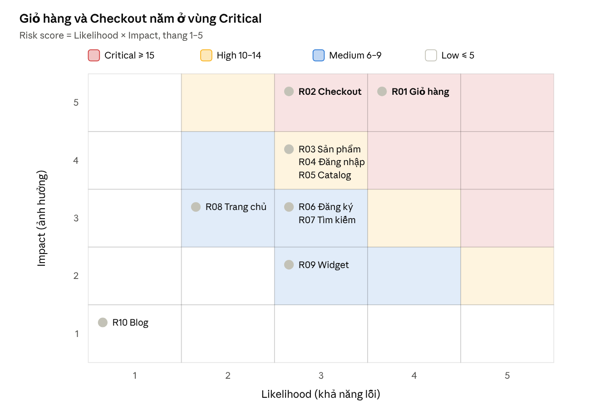
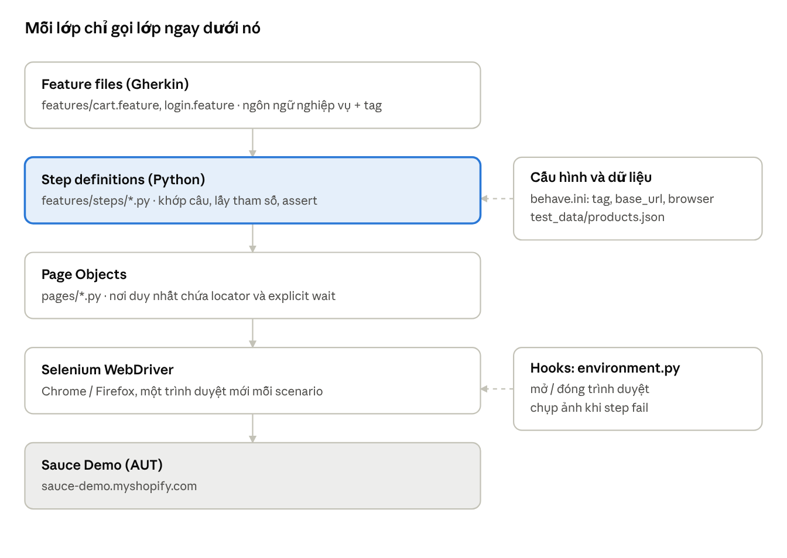

# Unit 1 – BDD Automation Design and Framework Practices (Sauce Demo)

behave (Cucumber cho Python) + Selenium WebDriver · Website kiểm thử: https://sauce-demo.myshopify.com · Code: chính repo này

Unit 1 đi từ phân tích rủi ro tới một framework BDD chạy được và đã được review: Day 1 quyết định automate gì, Day 2 dựng framework, Day 3 hoàn thiện đặc tả chạy được kèm báo cáo truy vết, Day 4 review và cải tiến.

| Day | Nội dung | LO | Hình thức | Phút | Format |
| --- | --- | --- | --- | --- | --- |
| Day 1 | Chiến lược automation theo rủi ro, phân tích testability, nguyên lý BDD | LO1 | Concept/Lecture | 120 | Virtual |
| Day 2 | Kiến trúc Cucumber/SpecFlow, thiết kế feature, step definitions, hooks, tags, mẫu báo cáo | LO2 | Concept/Lecture | 120 | Virtual |
| Day 3 | Lab BDD: đặc tả chạy được, step dùng lại, hooks, tags, báo cáo truy vết | LO2 | Assignment/Lab | 150 | Hybrid |
| Day 4 | Review framework BDD: bảo trì, truy vết, trùng lặp, hành động cải tiến | LO1, LO2 | Guides/Review | 60 | Hybrid |

Nội dung: Day 1 – Chiến lược · Day 2 – Kiến trúc · Day 3 – Lab · Day 4 – Review

---

## Day 1 – Risk-based Automation Strategy, Testability & BDD Principles

Unit 1 · LO1 · Concept/Lecture · 120 phút · Virtual

> Ghi chú: các feature mẫu ở mục 6 là bản cuối, chạy được, lấy từ `features/` (checkout.feature và register.feature được thêm ở Day 3). Mục 7 là kế hoạch cho Day 2–4 và ghi rõ phần Day 3 thêm vào.

Bài Day 1 chọn 5 luồng nghiệp vụ rủi ro cao nhất của Sauce Demo để tự động hóa trước (giỏ hàng, sản phẩm, đăng nhập, đăng ký, tìm kiếm), viết đặc tả bằng Gherkin và dùng Python + behave + Selenium WebDriver làm nền cho Day 2–4 (Playwright để dành cho Unit 2, từ Day 5).

### 0. Thông tin bài

| Mục                          | Nội dung                                                                                                                        |
|------------------------------|---------------------------------------------------------------------------------------------------------------------------------|
| Unit                         | Unit 1 – BDD Automation Design and Framework Practices                                                                          |
| Day / LO                     | Day 1 · LO1 (Concept/Lecture, 120 phút)                                                                                         |
| Chủ đề                       | Risk-based automation strategy, testability analysis, BDD principles                                                            |
| AUT (Application Under Test) | [Sauce Demo](https://sauce-demo.myshopify.com/) – cửa hàng Shopify demo, tiền tệ GBP (£)                                        |
| Ngôn ngữ / stack đề xuất     | Python 3.11+, behave (Cucumber cho Python), Selenium WebDriver 4 (Chrome/Firefox), Allure hoặc behave-html-formatter để báo cáo |
| Đầu ra Day 1                 | Chiến lược automation theo rủi ro, phân tích testability, sample requirements + Gherkin, ma trận truy vết sơ bộ                 |

Vì sao chọn behave: tài liệu khóa yêu cầu Cucumber hoặc SpecFlow; behave là bản Cucumber chính thức hơn cả trong hệ Python (feature file Gherkin, step definitions, hooks trong `environment.py`, tags). pytest-bdd là phương án thay thế nếu lớp muốn chạy chung với pytest.

### 1. Tổng quan hệ thống và danh mục tính năng

Sauce Demo có 10 khu vực chức năng; catalog hiện có 7 sản phẩm, trong đó 2 sản phẩm hết hàng (Brown Shades, White sandals), trang chủ hiển thị 3 sản phẩm nổi bật (khảo sát ngày 03/11/2026).

| ID  | Tính năng         | URL / vị trí                                        | Mô tả quan sát được                                                                        |
|-----|-------------------|-----------------------------------------------------|--------------------------------------------------------------------------------------------|
| F01 | Trang chủ         | `/`                                                 | Logo, menu, 3 sản phẩm nổi bật: Grey jacket £55.00, Noir jacket £60.00, Striped top £50.00 |
| F02 | Catalog           | `/collections/all`                                  | 7 sản phẩm, giá GBP, nhãn "Sold Out" cho hàng hết                                          |
| F03 | Chi tiết sản phẩm | `/products/<handle>`                                | Tên, giá, ảnh, mô tả, nút thêm vào giỏ, mục "You Might Also Like"                          |
| F04 | Giỏ hàng          | `/cart`, mini-cart "My Cart (n)" ở header           | Thêm/sửa số lượng/xóa, tổng tiền, nút Check Out                                            |
| F05 | Checkout          | Từ `/cart` sang trang checkout do Shopify host      | Nhập địa chỉ, giao hàng, thanh toán                                                        |
| F06 | Đăng nhập         | `/account/login`                                    | Email Address, Password, "Forgot your password?" mở form Reset Password                    |
| F07 | Đăng ký           | `/account/register`                                 | Tạo tài khoản khách hàng                                                                   |
| F08 | Tìm kiếm          | `/search`                                           | Tìm sản phẩm theo từ khóa                                                                  |
| F09 | Nội dung tĩnh     | `/blogs/news`, `/pages/about-us`                    | Blog, About Us                                                                             |
| F10 | Widget bên thứ ba | `#sauce-show-wish-list`, `#sauce-show-refer-friend` | Wish list, Refer a friend (ứng dụng Sauce), link mạng xã hội                               |

Dữ liệu sản phẩm dùng làm test data:

| Sản phẩm       | Giá    | Trạng thái | Handle trong URL     |
|----------------|--------|------------|----------------------|
| Black heels    | £45.00 | Còn hàng   | `flower-print-jeans` |
| Bronze sandals | £39.99 | Còn hàng   | `bronze-sandals`     |
| Brown Shades   | £20.00 | Sold Out   | `brown-shades`       |
| Grey jacket    | £55.00 | Còn hàng   | `grey-jacket`        |
| Noir jacket    | £60.00 | Còn hàng   | `noir-jacket`        |
| Striped top    | £50.00 | Còn hàng   | `striped-top`        |
| White sandals  | £25.00 | Sold Out   | `white-sandals`      |

Lưu ý: handle của Black heels là `flower-print-jeans`, không khớp tên — test không được suy URL từ tên sản phẩm (xem mục Testability).

### 2. Phân tích rủi ro (Risk assessment)

Giỏ hàng (20 điểm) và Checkout (15 điểm) là hai rủi ro Critical; chúng được tự động hóa trước, nội dung tĩnh (1 điểm) để kiểm thủ công.

Cách chấm: **Risk score = Likelihood × Impact**, mỗi trục từ 1 đến 5.

| Mức | Likelihood (khả năng lỗi)                           | Impact (ảnh hưởng nếu lỗi)          |
|-----|-----------------------------------------------------|-------------------------------------|
| 1   | Hầu như không đổi, logic tĩnh                       | Không ảnh hưởng mua hàng            |
| 3   | Thay đổi thỉnh thoảng, có logic/JS                  | Gây khó chịu, có cách vòng          |
| 5   | Logic phức tạp, nhiều biến thể, phụ thuộc bên ngoài | Mất doanh thu, sai tiền, lộ dữ liệu |

Ngưỡng ưu tiên: Critical ≥ 15 · High 10–14 · Medium 6–9 · Low ≤ 5.

| Risk ID | Tính năng             | Rủi ro cụ thể                                                                 | L   | I   | Score | Mức      |
|---------|-----------------------|-------------------------------------------------------------------------------|-----|-----|-------|----------|
| R01     | F04 Giỏ hàng          | Thêm sai sản phẩm, sai số lượng, tổng tiền tính sai, mini-cart không cập nhật | 4   | 5   | 20    | Critical |
| R02     | F05 Checkout          | Không chuyển được sang checkout, mất giỏ hàng khi chuyển trang                | 3   | 5   | 15    | Critical |
| R03     | F03 Chi tiết sản phẩm | Sai giá; vẫn cho mua sản phẩm Sold Out                                        | 3   | 4   | 12    | High     |
| R04     | F06 Đăng nhập         | Đăng nhập sai vẫn vào được; không báo lỗi; reset password hỏng                | 3   | 4   | 12    | High     |
| R05     | F02 Catalog           | Thiếu sản phẩm, giá hiển thị sai, nhãn Sold Out sai                           | 3   | 4   | 12    | High     |
| R06     | F07 Đăng ký           | Không validate email/mật khẩu, tạo trùng tài khoản                            | 3   | 3   | 9     | Medium   |
| R07     | F08 Tìm kiếm          | Không tìm thấy sản phẩm có thật, không xử lý từ khóa rỗng/ký tự đặc biệt      | 3   | 3   | 9     | Medium   |
| R08     | F01 Trang chủ & menu  | Link menu hỏng, sản phẩm nổi bật sai                                          | 2   | 3   | 6     | Medium   |
| R09     | F10 Widget bên thứ ba | Wish list / Refer a friend không mở                                           | 3   | 2   | 6     | Medium   |
| R10     | F09 Blog, About Us    | Sai nội dung tĩnh                                                             | 1   | 1   | 1     | Low      |



risk heat map · 10 rủi ro theo Likelihood × Impact

Hai rủi ro ở góc trên bên phải (R01, R02) quyết định bộ `@smoke`; cụm R03–R05 ở hàng Impact 4 là ưu tiên tiếp theo.

### 3. Chiến lược automation theo rủi ro

Automate theo thứ tự điểm rủi ro: Critical và High vào bộ `@smoke`/`@regression` ngay sprint đầu; Medium vào `@regression` sau; Low và những gì không kiểm soát được thì kiểm thủ công.

#### 3.1 Quyết định automate

| Risk ID               | Quyết định                 | Phạm vi automate                                                                       | Lý do                                                                      |
|-----------------------|----------------------------|----------------------------------------------------------------------------------------|----------------------------------------------------------------------------|
| R01 Giỏ hàng          | Automate – P1, `@smoke`    | Thêm 1 và nhiều sản phẩm, đổi số lượng, xóa, kiểm tổng tiền, đếm mini-cart             | Rủi ro cao nhất, chạy lặp lại nhiều, kết quả xác định được                 |
| R02 Checkout          | Automate một phần – P1     | Chỉ đến bước trang checkout hiển thị đúng sản phẩm và tổng                             | Không được thanh toán thật trên site demo; bước thanh toán do Shopify host |
| R03 Chi tiết SP       | Automate – P1              | Giá, tên, Sold Out không cho thêm vào giỏ                                              | Sai giá gây thiệt hại trực tiếp                                            |
| R04 Đăng nhập         | Automate – P1              | Sai mật khẩu, email sai định dạng, trường trống, mở form reset                         | Luồng bảo mật; không cần tài khoản thật cho các case âm                    |
| R05 Catalog           | Automate – P1              | Đủ 7 sản phẩm, giá, nhãn Sold Out (data-driven bằng Scenario Outline)                  | Dữ liệu ổn định, dễ so sánh bảng                                           |
| R06 Đăng ký           | Automate có điều kiện – P2 | Case validate lỗi; case tạo tài khoản dùng email sinh ngẫu nhiên, tag `@data-creating` | Tạo dữ liệu thật trên store, cần kiểm soát                                 |
| R07 Tìm kiếm          | Automate – P2              | Từ khóa có kết quả, không có kết quả, từ khóa rỗng                                     | Rẻ, ổn định                                                                |
| R08 Trang chủ & menu  | Automate – P3              | Kiểm link menu trả về trang đúng                                                       | Rẻ, dùng làm smoke kiểm môi trường sống                                    |
| R09 Widget bên thứ ba | Thủ công                   | –                                                                                      | Phụ thuộc ứng dụng ngoài, dễ flaky, không thuộc trách nhiệm AUT            |
| R10 Blog, About       | Thủ công / exploratory     | –                                                                                      | Giá trị thấp, nội dung tĩnh                                                |

#### 3.2 Phân tầng kiểm thử

Sauce Demo là store Shopify, nhóm test không có mã nguồn hay API nội bộ, nên tháp kiểm thử bị lệch về UI. Bù lại bằng: kiểm nhanh qua HTTP (status 200 cho các trang chính) cho tầng dưới, BDD UI end-to-end chỉ cho luồng nghiệp vụ, kiểm thủ công/exploratory cho phần còn lại.

#### 3.3 Hệ thống tag

| Tag                               | Ý nghĩa                                                    | Khi nào chạy                       |
|-----------------------------------|------------------------------------------------------------|------------------------------------|
| `@smoke`                          | Luồng tối thiểu: trang chủ mở, thêm vào giỏ, sang checkout | Mỗi lần deploy, \< 5 phút          |
| `@regression`                     | Toàn bộ scenario đã automate                               | Hằng đêm                           |
| `@critical` / `@high` / `@medium` | Mức rủi ro từ bảng mục 2                                   | Lọc khi thời gian chạy bị giới hạn |
| `@R01` … `@R10`                   | Risk ID, dùng cho truy vết                                 | Báo cáo coverage                   |
| `@REQ-xx`                         | Mã requirement                                             | Ma trận truy vết                   |
| `@negative`                       | Case âm                                                    | –                                  |
| `@data-creating`                  | Tạo dữ liệu thật trên store                                | Chỉ chạy khi được phép             |
| `@wip`, `@manual`                 | Đang viết / chỉ kiểm thủ công                              | Loại khỏi pipeline                 |

#### 3.4 Tiêu chí vào/ra

- Vào: site phản hồi trang chủ, catalog có đủ dữ liệu test ở mục 1, có Python 3.11+ và trình duyệt Chromium.

- Ra: 100% scenario `@critical` pass, ≥ 95% `@regression` pass, mọi fail đều có ảnh chụp và lỗi đã phân loại (lỗi sản phẩm hay lỗi script).

- Đo lường: số requirement có scenario / tổng requirement, tỷ lệ pass, tỷ lệ flaky (scenario fail rồi pass khi chạy lại), thời gian chạy bộ smoke.

### 4. Phân tích testability

Sauce Demo kiểm thử được ở mức trung bình: dữ liệu sản phẩm ổn định và URL rõ ràng, nhưng không có test id, không có môi trường riêng và checkout/thanh toán nằm ngoài tầm kiểm soát.

| Khía cạnh                               | Mức            | Quan sát                                                                                          | Hướng xử lý trong framework                                                                                                 |
|-----------------------------------------|----------------|---------------------------------------------------------------------------------------------------|-----------------------------------------------------------------------------------------------------------------------------|
| Controllability – điều khiển trạng thái | Trung bình     | Không có API reset giỏ hàng; giỏ lưu theo cookie                                                  | Mỗi scenario chạy trong browser context mới (cookie sạch) qua hook `before_scenario`                                        |
| Observability – quan sát kết quả        | Tốt            | Giá, tên SP, "My Cart (n)", nhãn Sold Out đều hiển thị dạng text                                  | Assert trên text hiển thị; chụp ảnh khi fail trong `after_step`                                                             |
| Locator                                 | Trung bình–yếu | Theme cũ, không có `data-testid`; có thể có class/name chuẩn của Shopify (ví dụ form `/cart/add`) | Ưu tiên locator theo text/name chuẩn của Shopify (`By.LINK_TEXT`, `By.NAME`), sau đó attribute ổn định; gom vào Page Object |
| Test data                               | Tốt            | 7 sản phẩm, giá cố định, 2 SP Sold Out                                                            | Giữ trong `shared/products.json`, không hard-code trong step                                                             |
| Định danh URL                           | Có bẫy         | Handle Black heels là `flower-print-jeans`                                                        | Map tên → handle trong test data, không suy URL từ tên                                                                      |
| Môi trường                              | Yếu            | Chỉ có production demo, dùng chung với người khác, không có staging                               | Không chạy tải; giới hạn song song; tag `@data-creating` cho case tạo tài khoản                                             |
| Phụ thuộc bên ngoài                     | Yếu            | Checkout và thanh toán do Shopify host; widget Sauce, mạng xã hội                                 | Dừng ở trang checkout; không automate widget; chặn request bên thứ ba để dành cho Playwright ở Unit 2 (Day 6–7)             |
| Đồng bộ (timing)                        | Trung bình     | Mini-cart cập nhật bằng JS sau khi thêm vào giỏ                                                   | Dùng explicit wait `WebDriverWait(...).until(...)` của Selenium, không dùng `sleep`                                         |
| Tài khoản test                          | Yếu            | Không có tài khoản cung cấp sẵn                                                                   | Case âm không cần tài khoản; case dương cần tạo tài khoản bằng email ngẫu nhiên, lưu vào biến môi trường                    |
| Bảo vệ chống bot                        | Rủi ro         | Shopify có thể bật captcha cho form đăng nhập/đăng ký khi gửi nhiều                               | Giới hạn số lần chạy; không vượt captcha; đánh dấu `@manual` nếu bị chặn                                                    |

Câu hỏi mở cho trainer: lớp có được phép tạo tài khoản thật trên store này không, và có cần dùng Allure hay chỉ báo cáo HTML/JSON.

### 5. Nguyên lý BDD áp dụng cho Sauce Demo

BDD là thống nhất hành vi bằng ví dụ cụ thể trước khi viết code; Gherkin là ngôn ngữ ghi lại ví dụ đó, automation chỉ là bước sau.

#### 5.1 Ba bước của BDD

1.  **Discovery** – Three Amigos (BA/PO, Dev, QA) trao đổi về một user story, dùng Example Mapping: thẻ vàng = story, thẻ xanh dương = rule, thẻ xanh lá = ví dụ, thẻ đỏ = câu hỏi chưa trả lời.

2.  **Formulation** – Chuyển ví dụ thành scenario Gherkin bằng ngôn ngữ nghiệp vụ.

3.  **Automation** – Nối từng step với code (step definitions trong behave), chạy như tài liệu sống.

Ví dụ Example Mapping cho story Giỏ hàng:

| Rule (xanh dương)                   | Ví dụ (xanh lá)                      | Câu hỏi (đỏ)                          |
|-------------------------------------|--------------------------------------|---------------------------------------|
| Thêm SP còn hàng thì mini-cart tăng | Thêm Grey jacket → My Cart (1)       | –                                     |
| Tổng = giá × số lượng               | 2 × Noir jacket → £120.00            | Có phí vận chuyển ở trang cart không? |
| SP Sold Out không thêm được         | Brown Shades → không có nút mua được | Nút ẩn hay bị disable?                |
| Xóa SP thì giỏ trống                | Xóa Striped top → giỏ báo trống      | –                                     |

#### 5.2 Quy tắc viết Gherkin

- Declarative, không imperative: mô tả *điều gì* xảy ra, không mô tả click vào đâu.

- Một scenario kiểm một hành vi; tối đa khoảng 5–7 step.

- Given = trạng thái, When = một hành động, Then = kết quả quan sát được.

- Dùng ngôn ngữ của người dùng (sản phẩm, giỏ hàng), không nhắc locator, URL, CSS.

- Dữ liệu thay đổi → `Scenario Outline` + `Examples`; bước chung → `Background`.

- Mỗi scenario độc lập, không phụ thuộc thứ tự chạy.

- Gắn tag rủi ro và requirement để truy vết.

#### 5.3 Ví dụ xấu và tốt

Xấu (imperative, gắn với giao diện):

```gherkin
Scenario: add to cart
  Given I open "https://sauce-demo.myshopify.com/collections/all"
  When I click on "a[href*='grey-jacket']"
  And I click the button with id "add"
  And I wait 3 seconds
  Then the element "#cart-count" should contain "1"
```

Tốt (declarative, nghiệp vụ):

```gherkin
@REQ-01 @R01 @critical @smoke
Scenario: Customer adds an in-stock product to the cart
  Given the customer is viewing the product "Grey jacket"
  When the customer adds the product to the cart
  Then the cart should contain 1 item
  And the cart total should be "£55.00"
```

### 6. Sample requirements và Gherkin mẫu

Tám requirement dưới đây phủ toàn bộ rủi ro Critical, High và Medium đã chọn automate; mỗi requirement có acceptance criteria (AC) dùng trực tiếp làm scenario.

| REQ    | User story                                           | Acceptance criteria                                                                                  | Risk |
|--------|------------------------------------------------------|------------------------------------------------------------------------------------------------------|------|
| REQ-01 | Là khách hàng, tôi muốn thêm sản phẩm vào giỏ để mua | AC1 thêm SP còn hàng → mini-cart tăng 1; AC2 tổng tiền = giá × số lượng                              | R01  |
| REQ-02 | Là khách hàng, tôi muốn sửa/xóa sản phẩm trong giỏ   | AC1 đổi số lượng → tổng cập nhật; AC2 xóa hết → giỏ báo trống                                        | R01  |
| REQ-03 | Là khách hàng, tôi muốn chuyển sang thanh toán       | AC1 từ giỏ có hàng bấm Check Out → mở trang checkout với đúng SP                                     | R02  |
| REQ-04 | Là khách hàng, tôi muốn xem đúng thông tin sản phẩm  | AC1 tên và giá khớp catalog; AC2 SP Sold Out không thêm được vào giỏ                                 | R03  |
| REQ-05 | Là khách hàng, tôi muốn đăng nhập an toàn            | AC1 sai thông tin → báo lỗi, không vào tài khoản; AC2 "Forgot your password?" mở form reset          | R04  |
| REQ-06 | Là khách hàng, tôi muốn xem danh sách sản phẩm       | AC1 catalog hiển thị đủ 7 SP với giá đúng; AC2 SP hết hàng có nhãn Sold Out                          | R05  |
| REQ-07 | Là khách mới, tôi muốn tạo tài khoản                 | AC1 thiếu trường bắt buộc → báo lỗi; AC2 thông tin hợp lệ → tạo được tài khoản                       | R06  |
| REQ-08 | Là khách hàng, tôi muốn tìm sản phẩm theo từ khóa    | AC1 "jacket" → có Grey jacket và Noir jacket; AC2 từ khóa không tồn tại → thông báo không có kết quả | R07  |

#### 6.1 Feature mẫu – Giỏ hàng (`features/cart.feature`)

```gherkin
@cart @R01
Feature: Shopping cart
  As a customer
  I want to manage products in my cart
  So that I can buy what I need

  @REQ-01 @critical @smoke
  Scenario: Add an in-stock product to the cart
    Given the customer is viewing the product "Grey jacket"
    When the customer adds the product to the cart
    Then the cart should contain 1 item
    And the cart total should be "£55.00"

  @REQ-01 @critical @regression
  Scenario Outline: Cart total equals price times quantity
    Given the customer has <quantity> of "<product>" in the cart
    When the customer opens the cart
    Then the cart should contain <quantity> items
    And the cart total should be "<total>"

    Examples:
      | product     | quantity | total   |
      | Noir jacket | 2        | £120.00 |
      | Striped top | 3        | £150.00 |

  @REQ-02 @critical @regression
  Scenario: Change the quantity of a product in the cart
    Given the customer has 1 of "Bronze sandals" in the cart
    When the customer changes the quantity of "Bronze sandals" to 2
    Then the cart should contain 2 items
    And the cart total should be "£79.98"

  @REQ-02 @critical @regression
  Scenario: Remove the only product from the cart
    Given the customer has 1 of "Striped top" in the cart
    When the customer removes "Striped top" from the cart
    Then the cart should be empty
```

#### 6.2 Feature mẫu – Sản phẩm và catalog (`features/product.feature`)

```gherkin
@product
Feature: Product information
  As a customer
  I want correct product names, prices and stock status
  So that I know what I am buying

  @REQ-06 @R05 @high @regression
  Scenario Outline: Catalog shows correct price and stock status
    When the customer browses the full catalog
    Then the product "<product>" should be listed at its catalog price
    And the product "<product>" should be shown as "<status>"

    Examples:
      | product        | status    |
      | Black heels    | available |
      | Bronze sandals | available |
      | Brown Shades   | sold out  |
      | Grey jacket    | available |
      | Noir jacket    | available |
      | Striped top    | available |
      | White sandals  | sold out  |

  @REQ-04 @R03 @high @regression
  Scenario: Product page shows the catalog name and price
    Given the customer is viewing the product "Noir jacket"
    Then the product page should show the name "Noir jacket"
    And the product page should show the price "£60.00"

  @REQ-04 @R03 @high @negative @regression
  Scenario: A sold-out product cannot be added to the cart
    Given the customer is viewing the product "Brown Shades"
    Then the customer should not be able to add it to the cart
```

#### 6.3 Feature mẫu – Đăng nhập (`features/login.feature`)

```gherkin
@login @R04
Feature: Customer login
  As a customer
  I want only valid credentials to log me in
  So that my account stays safe

  Background:
    Given the customer is on the login page

  @REQ-05 @high @negative @regression
  Scenario Outline: Login is rejected with invalid credentials
    When the customer logs in with email "<email>" and password "<password>"
    Then a login error should be shown
    And the customer should not be logged in

    Examples:
      | email                  | password   |
      | not-a-user@example.com | wrongpass1 |
      | not-an-email           | wrongpass1 |

  @REQ-05 @high @regression
  Scenario: Customer opens the password reset form
    When the customer chooses to reset the password
    Then the password reset form should be shown
```

#### 6.4 Feature mẫu – Tìm kiếm (`features/search.feature`)

```gherkin
@search @R07 @medium
Feature: Product search
  As a customer
  I want to find products by keyword
  So that I do not have to browse the whole catalog

  @REQ-08 @regression
  Scenario: Search returns matching products
    Given the customer is on the home page
    When the customer searches for "jacket"
    Then the results should include "Grey jacket"
    And the results should include "Noir jacket"

  @REQ-08 @negative @regression
  Scenario: Search with no matching products
    Given the customer is on the home page
    When the customer searches for "zzqxnotaproduct"
    Then no products should be shown in the results
```

Các step dùng lại được (ví dụ `the customer is viewing the product "..."`, `the cart total should be "..."`) sẽ là bộ step template cho Day 2–3.

### 7. Truy vết, kế hoạch tiếp theo và rubric

6 trên 8 requirement đã có scenario Gherkin ở mục 6; REQ-03 (checkout) và REQ-07 (đăng ký) được đặc tả ở Day 3 trong `checkout.feature` và `register.feature`.

#### 7.1 Ma trận truy vết sơ bộ

| REQ | Risk | Mức | Feature file | Scenario | Trạng thái |
| --- | --- | --- | --- | --- | --- |
| REQ-01 | R01 | Critical | cart.feature | Add an in-stock product; Cart total equals price times quantity | Đã đặc tả |
| REQ-02 | R01 | Critical | cart.feature | Change the quantity; Remove the only product from the cart | Đã đặc tả |
| REQ-03 | R02 | Critical | checkout.feature | Checkout opens from a non-empty cart | Thêm ở Day 3 |
| REQ-04 | R03 | High | product.feature | Product page shows the catalog name and price; A sold-out product cannot be added | Đã đặc tả |
| REQ-05 | R04 | High | login.feature | Login is rejected with invalid credentials; Customer opens the password reset form | Đã đặc tả |
| REQ-06 | R05 | High | product.feature | Catalog shows correct price and stock status | Đã đặc tả |
| REQ-07 | R06 | Medium | register.feature | Registration is rejected without an email; Registration succeeds (`@data-creating`) | Thêm ở Day 3 |
| REQ-08 | R07 | Medium | search.feature | Search returns matching products; Search with no matching products | Đã đặc tả |

Truy vết được tự động hóa bằng tag: mỗi scenario mang `@REQ-xx` và `@Rxx`, báo cáo JSON của behave được đọc lại để sinh ma trận này ở Day 3.

#### 7.2 Cấu trúc project Python dự kiến (dựng ở Day 2)

```text
sauce-demo-unit1-bdd/
├── features/
│   ├── cart.feature, product.feature, login.feature, search.feature, ...
│   ├── steps/            # step definitions dùng lại được
│   └── environment.py    # hooks: before_all, before_scenario, after_step, after_scenario
├── pages/                # Page Object: home, catalog, product, cart, login, search
├── shared/products.json      # dữ liệu test (repo Unit 2 có cùng file)
├── reports/              # HTML/JSON/Allure + ảnh chụp lỗi
├── behave.ini
└── requirements.txt      # behave, selenium, behave-html-formatter, allure-behave
```

#### 7.3 Kế hoạch Day 2–4

| Day   | Việc cần làm                                                                                                   | Đầu ra                                                    |
|-------|----------------------------------------------------------------------------------------------------------------|-----------------------------------------------------------|
| Day 2 | Dựng cấu trúc behave + Selenium, Page Object, viết step definitions, hooks, tag                                | Project chạy được `behave --dry-run` không còn step thiếu |
| Day 3 | Lab: hoàn thiện scenario REQ-01 → REQ-08, chụp ảnh khi fail, báo cáo HTML/Allure, sinh ma trận truy vết từ tag | Repo + báo cáo chạy thật                                  |
| Day 4 | Review theo rubric dưới, tìm step trùng lặp, đề xuất cải tiến                                                  | Bảng review + danh sách action                            |

#### 7.4 Rubric tự review (dùng lại ở Day 4)

| Tiêu chí               | Đạt khi                                                                | Tự chấm (0–2) |
|------------------------|------------------------------------------------------------------------|---------------|
| Rủi ro dẫn dắt phạm vi | Mọi rủi ro Critical/High có scenario; lý do không automate được ghi rõ |               |
| Gherkin declarative    | Không có locator, URL, `wait` trong feature file                       |               |
| Độc lập                | Mỗi scenario chạy riêng lẻ được, không phụ thuộc thứ tự                |               |
| Tái sử dụng step       | Không có hai step cùng nghĩa khác câu chữ                              |               |
| Truy vết               | Mọi scenario có `@REQ-xx` và `@Rxx`                                    |               |
| Dữ liệu tách khỏi code | Giá, tên SP, handle nằm trong test data / Examples                     |               |
| Báo cáo                | Có báo cáo HTML/JSON, ảnh chụp khi fail                                |               |
| Ổn định                | Không dùng `sleep`; chạy 3 lần liên tiếp cùng kết quả                  |               |

---

## Day 2 – Kiến trúc Cucumber (behave): Feature, Step Definitions, Hooks, Tags & Reporting

Unit 1 · LO2 · Concept/Lecture · 120 phút · Virtual

Day 2 biến các đặc tả Gherkin của Day 1 thành một framework behave + Selenium chạy được: 2 feature (giỏ hàng, đăng nhập), 8 scenario, các step definitions mà chúng dùng, 4 hook, hệ thống tag và 3 loại báo cáo. Code Unit 1 chính là repo này; Day 2 giải thích kiến trúc qua `cart.feature` và `login.feature`.

### 0. Thông tin bài

| Mục              | Nội dung                                                                                                                                             |
|------------------|------------------------------------------------------------------------------------------------------------------------------------------------------|
| Unit             | Unit 1 – BDD Automation Design and Framework Practices                                                                                               |
| Day / LO         | Day 2 · LO2 (Concept/Lecture, 120 phút, Virtual)                                                                                                     |
| Chủ đề           | Kiến trúc Cucumber/SpecFlow, thiết kế feature, step definitions, hooks, tags, reporting patterns                                                     |
| AUT              | [Sauce Demo](https://sauce-demo.myshopify.com/)                                                                                                      |
| Stack            | Python 3.11+, behave 1.3 (Cucumber cho Python), Selenium WebDriver 4, behave-html-formatter, allure-behave                                           |
| Đầu vào từ Day 1 | Risk register, REQ-01…REQ-08, feature nháp có tag `@REQ-xx` / `@Rxx`                                                                                 |
| Đầu ra Day 2     | Framework khởi đầu chạy được; `behave --dry-run` không còn step thiếu; cart + login chạy thật                                                        |
| Phạm vi          | REQ-01, REQ-02 (giỏ hàng, R01 Critical) và REQ-05 (đăng nhập, R04 High) – hai rủi ro cao nhất có thể automate trọn vẹn. Các REQ còn lại làm ở Day 3. |

Playwright không dùng ở Unit 1; Unit 2 (từ Day 5) mới chuyển sang Playwright.

### 1. Kiến trúc Cucumber / behave

Framework gồm 4 lớp, mỗi lớp chỉ biết lớp ngay dưới nó: feature file (nghiệp vụ) → step definitions (keo nối) → Page Object (giao diện) → Selenium WebDriver (trình duyệt). Hooks và cấu hình bao quanh cả vòng chạy.



kiến trúc sauce-demo-unit1-bdd · 5 lớp + hooks + cấu hình

Khi theme đổi giao diện, chỉ lớp Page Object phải sửa; feature và step giữ nguyên.

| Lớp                | File trong repo            | Trách nhiệm                                                | Không được chứa         |
|--------------------|-----------------------------------------|------------------------------------------------------------|-------------------------|
| Feature            | `features/*.feature`                    | Hành vi bằng ngôn ngữ nghiệp vụ, tag                       | Locator, URL, wait      |
| Step definitions   | `features/steps/*.py`                   | Khớp câu Gherkin, lấy tham số, gọi Page Object, assert     | Locator, `find_element` |
| Page Object        | `pages/*.py`                            | Locator và thao tác trên từng trang, explicit wait         | Assert nghiệp vụ        |
| Driver             | Selenium WebDriver                      | Điều khiển Chrome/Firefox                                  | –                       |
| Hooks              | `features/environment.py`               | Mở/đóng trình duyệt, bỏ qua tag, chụp ảnh khi fail         | Logic nghiệp vụ         |
| Cấu hình / dữ liệu | `behave.ini`, `shared/products.json` | Tag mặc định, base_url, browser; tên, handle, giá sản phẩm | –                       |

Cấu trúc thư mục:

```text
sauce-demo-unit1-bdd/
├── behave.ini                 # cấu hình: tag mặc định, userdata, formatter
├── requirements.txt           # behave, selenium, behave-html-formatter, allure-behave
├── features/
│   ├── cart.feature           # REQ-01, REQ-02
│   ├── login.feature          # REQ-05
│   ├── environment.py         # hooks
│   └── steps/
│       ├── common_steps.py    # điều hướng dùng chung
│       ├── cart_steps.py
│       └── account_steps.py
├── pages/                     # BasePage, ProductPage, CartPage, CatalogPage, LoginPage
├── support/helpers.py         # page(), product(): hàm dùng chung cho steps
├── shared/products.json      # dữ liệu test (repo Unit 2 có cùng file)
└── reports/
```

Vì sao `support/helpers.py` nằm ngoài `features/steps/`: behave tự nạp mọi file trong `steps/`; nếu một file step import file step khác, các decorator `@given/@when/@then` chạy hai lần và behave báo `AmbiguousStep`.

### 2. Thiết kế feature file

Mỗi feature file ứng với một khả năng nghiệp vụ; tag ở cấp Feature áp cho mọi scenario bên dưới, tag ở cấp Scenario chỉ áp cho scenario đó.

| Từ khóa                                   | Dùng khi                                   | Ví dụ trong code                          |
|-------------------------------------------|--------------------------------------------|-------------------------------------------|
| `Feature` + mô tả As a / I want / So that | Gom các scenario của một khả năng          | `Feature: Shopping cart`                  |
| `Background`                              | Bước Given lặp lại ở mọi scenario của file | `Given the customer is on the login page` |
| `Scenario`                                | Một ví dụ cụ thể                           | Add an in-stock product to the cart       |
| `Scenario Outline` + `Examples`           | Cùng hành vi, nhiều bộ dữ liệu             | 2 × Noir jacket, 3 × Striped top          |
| `@tag`                                    | Phân loại để lọc và truy vết               | `@REQ-01 @critical @smoke`                |

`features/cart.feature`:

```gherkin
@cart @R01
Feature: Shopping cart
  As a customer
  I want to manage products in my cart
  So that I can buy what I need

  @REQ-01 @critical @smoke
  Scenario: Add an in-stock product to the cart
    Given the customer is viewing the product "Grey jacket"
    When the customer adds the product to the cart
    Then the cart should contain 1 item
    And the cart total should be "£55.00"

  @REQ-01 @critical @regression
  Scenario Outline: Cart total equals price times quantity
    Given the customer has <quantity> of "<product>" in the cart
    When the customer opens the cart
    Then the cart should contain <quantity> items
    And the cart total should be "<total>"

    Examples:
      | product     | quantity | total   |
      | Noir jacket | 2        | £120.00 |
      | Striped top | 3        | £150.00 |

  @REQ-02 @critical @regression
  Scenario: Change the quantity of a product in the cart
    Given the customer has 1 of "Bronze sandals" in the cart
    When the customer changes the quantity of "Bronze sandals" to 2
    Then the cart should contain 2 items
    And the cart total should be "£79.98"

  @REQ-02 @critical @regression
  Scenario: Remove the only product from the cart
    Given the customer has 1 of "Striped top" in the cart
    When the customer removes "Striped top" from the cart
    Then the cart should be empty
```

`features/login.feature` (minh họa `Background` và case âm):

```gherkin
@login @R04
Feature: Customer login
  As a customer
  I want only valid credentials to log me in
  So that my account stays safe

  Background:
    Given the customer is on the login page

  @REQ-05 @high @negative @regression
  Scenario Outline: Login is rejected with invalid credentials
    When the customer logs in with email "<email>" and password "<password>"
    Then a login error should be shown
    And the customer should not be logged in

    Examples:
      | email                  | password   |
      | not-a-user@example.com | wrongpass1 |
      | not-an-email           | wrongpass1 |

  @REQ-05 @high @regression
  Scenario: Customer opens the password reset form
    When the customer chooses to reset the password
    Then the password reset form should be shown
```

Quy tắc áp dụng: Given = trạng thái, When = một hành động, Then = kết quả quan sát được; không có URL, CSS hay `wait` trong feature; mỗi scenario ≤ 7 step.

### 3. Step definitions

Mỗi câu Gherkin khớp với đúng một hàm Python qua decorator `@given / @when / @then`; behave so khớp toàn bộ câu (không phân biệt từ khóa Given/And), nên một step viết một lần dùng được ở mọi feature.

#### 3.1 Tham số (parse matcher mặc định)

| Cú pháp              | Khớp            | Giá trị trong hàm                             |
|----------------------|-----------------|-----------------------------------------------|
| `"{name}"`           | `"Grey jacket"` | `name = "Grey jacket"` (str)                  |
| `{quantity:d}`       | `2`             | `quantity = 2` (int)                          |
| `"{expected}"`       | `"£55.00"`      | chuỗi, chuyển sang số bằng `money_to_float()` |
| Matcher `re` (Day 4) | `items?`        | regex khi cần biến thể số ít/số nhiều         |

#### 3.2 Code `features/steps/cart_steps.py`

```python
"""Cart steps (REQ-01, REQ-02)."""
from behave import given, then, when

from pages import CartPage, ProductPage, money_to_float
from support.helpers import page, product


@given('the customer has {quantity:d} of "{name}" in the cart')
def step_has_in_cart(context, quantity, name):
    product_page = page(context, ProductPage)
    product_page.open_product(product(context, name)["handle"])
    product_page.add_to_cart(quantity)


@when("the customer adds the product to the cart")
def step_add_current(context):
    page(context, ProductPage).add_to_cart(1)


@when('the customer changes the quantity of "{name}" to {quantity:d}')
def step_change_qty(context, name, quantity):
    cart = page(context, CartPage).open()
    cart.set_quantity(name, quantity)


# Day 4 (phát hiện F1) gộp "item"/"items" thành một step regex:
use_step_matcher("re")


@then(r"the cart should contain (?P<count>\d+) items?")
def step_cart_count(context, count):
    count = int(count)
    cart = page(context, CartPage).open()
    actual = cart.total_quantity()
    assert actual == count, f"Expected {count} item(s) in the cart, found {actual}"
    assert cart.mini_cart_count() == count, f"Mini-cart shows {cart.mini_cart_count()}, expected {count}"


@then('the cart total should be "{expected}"')
def step_cart_total(context, expected):
    cart = page(context, CartPage).open()
    actual = cart.total()
    assert actual == money_to_float(expected), f"Expected total {expected}, found £{actual:.2f}"
```

#### 3.3 Hàm dùng chung `support/helpers.py`

```python
def product(context, name):
    """Look up test data by product name; fail loudly on an unknown name."""
    try:
        return context.products[name]
    except KeyError:
        raise AssertionError(f"Unknown product {name!r}: add it to shared/products.json")


def page(context, cls):
    """Build a Page Object bound to this scenario's browser."""
    return cls(context.driver, context.base_url, context.timeout)
```

#### 3.4 Page Object mà step gọi tới (`pages/product_page.py`, rút gọn)

```python
ADD_FORM = "form[action*='/cart/add']"            # standard Shopify add-to-cart form
ADD_BUTTON = ADD_FORM + " [type='submit']"


class ProductPage(BasePage):
    def open_product(self, handle: str):
        return self.open(f"/products/{handle}")

    def add_to_cart(self, quantity: int = 1):
        qty = self.find_all(By.CSS_SELECTOR, ADD_FORM + " input[name='quantity']")
        if qty:
            qty[0].clear()
            qty[0].send_keys(str(quantity))
            self._submit()
        else:  # theme without a quantity box: add the product N times
            ...

    def _submit(self):
        self.submit(By.CSS_SELECTOR, ADD_BUTTON)   # BasePage.submit: click + wait for the new page
        self.wait.until(lambda d: "/cart" in d.current_url and "/products/" not in d.current_url)


# pages/base_page.py – used by every form button (Add to Cart, Update, Check Out, Sign In)
def submit(self, by, value):
    old_page = self.driver.find_element(By.TAG_NAME, "html")
    self.click(by, value)
    self.wait.until(EC.staleness_of(old_page))     # explicit wait, never time.sleep
```

Quy tắc viết step:

- Step không chứa locator; mọi locator nằm trong `pages/`.

- Dữ liệu (handle, giá) lấy từ `shared/products.json`, không gõ cứng.

- Assert có thông điệp nói rõ mong đợi và thực tế để báo cáo đọc được.

- Trạng thái giữa các step để trong `context` (ví dụ `context.driver`), không dùng biến toàn cục.

- `behave --dry-run` in ra snippet cho step chưa có code – cách nhanh nhất để biết còn thiếu gì.

### 4. Hooks

Hooks nằm trong `features/environment.py` và lo mọi việc setup/teardown, nhờ đó feature và step chỉ còn nói về nghiệp vụ. Framework Day 2 dùng 4 hook.

Thứ tự behave gọi hook trong một lần chạy:

1.  `before_all` – một lần khi bắt đầu.

2.  `before_feature` – mỗi feature (Day 2 không dùng).

3.  `before_tag` – mỗi tag của scenario (Day 2 không dùng).

4.  `before_scenario` – mỗi scenario, kể cả từng dòng Examples.

5.  `before_step` / `after_step` – quanh mỗi step.

6.  `after_scenario`, `after_feature`, `after_all` – theo thứ tự ngược lại.

| Hook              | Việc làm trong repo                                                                            | Vì sao                                                |
|-------------------|------------------------------------------------------------------------------------------------------------|-------------------------------------------------------|
| `before_all`      | Đọc `base_url`, `browser`, `headless`, `timeout` từ biến môi trường hoặc `behave.ini`; nạp `products.json` | Một nguồn cấu hình, đổi môi trường không cần sửa code |
| `before_scenario` | Bỏ qua `@manual`/`@wip`; mở trình duyệt mới                                                                | Cookie sạch → giỏ hàng trống → scenario độc lập       |
| `after_step`      | Step fail → chụp ảnh vào `reports/screenshots/`, đính kèm Allure                                           | Bằng chứng để phân loại lỗi sản phẩm hay lỗi script   |
| `after_scenario`  | Đóng trình duyệt                                                                                           | Không rò tài nguyên, không dùng chung trạng thái      |

Code `features/environment.py`:

```python
import json
import os
import re
import sys
from pathlib import Path

from selenium import webdriver

ROOT = Path(__file__).resolve().parent.parent
sys.path.insert(0, str(ROOT))  # makes pages/ and support/ importable from steps
SCREENSHOTS = ROOT / "reports" / "screenshots"


def _make_driver(browser: str, headless: bool):
    if browser == "firefox":
        options = webdriver.FirefoxOptions()
        if headless:
            options.add_argument("-headless")
        return webdriver.Firefox(options=options)
    options = webdriver.ChromeOptions()
    if headless:
        options.add_argument("--headless=new")
    options.add_argument("--window-size=1366,900")
    return webdriver.Chrome(options=options)  # Selenium Manager downloads the matching driver


def before_all(context):
    userdata = context.config.userdata
    context.base_url = os.getenv("BASE_URL", userdata.get("base_url", "https://sauce-demo.myshopify.com"))
    context.browser_name = os.getenv("BROWSER", userdata.get("browser", "chrome"))
    context.headless = os.getenv("HEADLESS", userdata.get("headless", "true")).lower() == "true"
    context.timeout = int(userdata.get("timeout", "10"))
    with open(ROOT / "shared" / "products.json", encoding="utf-8") as fh:
        context.products = json.load(fh)["products"]
    SCREENSHOTS.mkdir(parents=True, exist_ok=True)


def before_scenario(context, scenario):
    if {"manual", "wip"} & set(scenario.effective_tags):
        scenario.skip("Tagged @manual / @wip")
        return
    context.driver = _make_driver(context.browser_name, context.headless)
    context.driver.implicitly_wait(0)  # explicit waits only


def after_step(context, step):
    if step.status == "failed" and getattr(context, "driver", None):
        name = re.sub(r"[^\w-]+", "_", f"{context.scenario.name}_{step.name}")[:120]
        path = SCREENSHOTS / f"{name}.png"
        context.driver.save_screenshot(str(path))
        try:  # attach to the Allure report when allure-behave is the formatter
            import allure
            allure.attach.file(str(path), name="failure", attachment_type=allure.attachment_type.PNG)
        except Exception:
            pass


def after_scenario(context, scenario):
    driver = getattr(context, "driver", None)
    if driver:
        driver.quit()
        context.driver = None
```

Bản trong file zip có thêm vài dòng cho Docker/CI (`--no-sandbox`, `CHROMEDRIVER_PATH`); trên máy cá nhân không cần.

### 5. Tags

Tag làm ba việc: chọn scenario sẽ chạy, điều khiển hook (bỏ qua `@manual`), và gắn scenario với requirement/rủi ro để truy vết.

| Nhóm       | Tag                                 | Dùng trong Day 2                          |
|------------|-------------------------------------|-------------------------------------------|
| Bộ chạy    | `@smoke`, `@regression`             | Add an in-stock product = `@smoke`        |
| Mức rủi ro | `@critical`, `@high`, `@medium`     | Giỏ hàng `@critical`, đăng nhập `@high`   |
| Truy vết   | `@R01`…`@R10`, `@REQ-01`…`@REQ-08`  | `@R01` + `@REQ-01/02`; `@R04` + `@REQ-05` |
| Loại case  | `@negative`                         | Login sai thông tin                       |
| Kiểm soát  | `@manual`, `@wip`, `@data-creating` | Bị loại theo mặc định                     |
| Khả năng   | `@cart`, `@login`                   | Tag cấp Feature                           |

Biểu thức lọc (behave 1.3, cú pháp tag expression v2):

```bash
behave --tags=@smoke                                  # chỉ smoke
behave --tags="@critical and not @negative"           # critical, bỏ case âm
behave --tags="@REQ-01 or @REQ-05"                    # theo requirement
behave --tags=@R01                                    # theo rủi ro
behave --tags="@data-creating or not @data-creating"  # chạy tất cả, ghi đè mặc định
```

`behave.ini` đặt bộ lọc mặc định và cấu hình:

```ini
[behave]
paths = features
# Default filter: never run manual, work-in-progress or data-creating scenarios.
tags = not @manual and not @wip and not @data-creating
show_skipped = false
default_format = pretty
junit = true
junit_directory = reports/junit

[behave.userdata]
base_url = https://sauce-demo.myshopify.com
browser = chrome
headless = true
timeout = 10

[behave.formatters]
html = behave_html_formatter:HTMLFormatter
```

`[behave.userdata]` có thể ghi đè khi chạy: `behave -D browser=firefox -D headless=false`, hoặc bằng biến môi trường `BASE_URL`, `BROWSER`, `HEADLESS`.

### 6. Reporting patterns

Mỗi người đọc cần một loại báo cáo khác nhau, và behave xuất được nhiều loại trong cùng một lần chạy.

| Formatter             | Lệnh                                                                   | Đầu ra                             | Dành cho                             |
|-----------------------|------------------------------------------------------------------------|------------------------------------|--------------------------------------|
| `pretty` / `progress` | `-f pretty`, `-f progress`                                             | Console                            | Người chạy test                      |
| JSON                  | `-f json.pretty -o reports/results.json`                               | File JSON                          | Script truy vết (Day 3), dashboard   |
| HTML                  | `-f html -o reports/report.html`                                       | Trang HTML (behave-html-formatter) | Trainer, BA, PO                      |
| JUnit XML             | `junit = true` trong `behave.ini`                                      | `reports/junit/*.xml`              | CI (Jenkins, GitHub Actions, GitLab) |
| Allure                | `-f allure_behave.formatter:AllureFormatter -o reports/allure-results` | Kết quả Allure + ảnh đính kèm      | Xem lịch sử, xu hướng                |
| Ảnh chụp              | Hook `after_step`                                                      | `reports/screenshots/*.png`        | Phân tích lỗi                        |

Chạy nhiều formatter cùng lúc. behave ghép mỗi `-o` với `-f` đứng ngay trước, nên formatter in ra console phải để cuối:

```bash
behave -f json.pretty -o reports/results.json \
       -f html -o reports/report.html \
       -f progress
```

Nếu để `-f progress` đầu tiên, nội dung progress sẽ bị ghi vào `results.json` và JSON bị ghi vào `report.html` – lỗi hay gặp. Day 3 gói lệnh này vào `run.py` để không phải nhớ.

Xem Allure: `allure serve reports/allure-results` (cần cài Allure CLI).

### 7. Chạy, kết quả và ôn tập

#### 7.1 Các bước chạy

```bash
cd sauce-demo-unit1-bdd
pip install -r requirements.txt
behave --dry-run                 # 1. mọi step đã có code? (không mở trình duyệt)
behave --tags=@smoke             # 2. smoke: 1 scenario
behave features/cart.feature features/login.feature   # 3. phần Day 2: 8 scenario
behave -D headless=false         # xem trình duyệt chạy
```

Yêu cầu: Python 3.11+ và Chrome; Selenium Manager tự tải chromedriver.

#### 7.2 Kết quả mong đợi

| Kiểm tra                                             | Kết quả                                                                    |
|------------------------------------------------------|----------------------------------------------------------------------------|
| `behave --dry-run`                                   | 0 step undefined                                                           |
| `behave`                                             | 2 feature, 8 scenario, 30 step pass                                        |
| Review tự động (`python scripts/bdd_review.py .`) | 0 phát hiện: cặp gần trùng `item`/`items` mà buổi review Day 4 tìm ra đã được gộp thành một step regex (phát hiện F1) |

Các số trên đã chạy trên một site giả lập cấu trúc Shopify. Chạy trên Sauce Demo thật nếu có step lỗi do locator, chỉ sửa trong `pages/`.

#### 7.3 Câu hỏi ôn tập

1.  Vì sao step definition không được chứa locator?

2.  `Background` khác hook `before_scenario` thế nào? Khi nào dùng cái nào?

3.  Viết biểu thức tag chỉ chạy scenario `@critical` không phải `@negative`.

4.  Giải thích vì sao mở trình duyệt mới trong `before_scenario` làm các scenario độc lập.

5.  Thay đổi gì khi theme đổi nút "Add to Cart" từ `input` sang `button`? Sửa ở file nào?

#### 7.4 Cầu nối sang Day 3

Day 3 giữ nguyên kiến trúc này và thêm: `checkout.feature`, `product.feature`, `register.feature`, `search.feature` (hoàn thành REQ-01…REQ-08), `product_steps.py`, `search_steps.py`, `run.py` (mọi báo cáo một lệnh) và `scripts/traceability.py` (ma trận truy vết từ tag).

---

## Day 3 – BDD Implementation Lab: Executable Specs, Reusable Steps, Hooks, Tags & Traceable Reports

Unit 1 · LO2 · Assignment/Lab · 150 phút · Hybrid · Code: repo `sauce-demo-unit1-bdd` (behave + Selenium)

Day 3 hoàn thiện framework của Day 2: 6 feature file, 14 scenario (22 lần chạy tính cả Examples) phủ đủ 8 requirement của Unit 1; một lệnh duy nhất xuất báo cáo HTML/JSON/JUnit/Allure và ma trận truy vết sinh từ tag.

### 1. Phần thêm vào so với Day 2

| Thêm | File | Mục đích |
| --- | --- | --- |
| Đặc tả checkout | `features/checkout.feature` | REQ-03, R02 Critical, dừng ở trang checkout |
| Đặc tả sản phẩm, catalog | `features/product.feature` | REQ-04, REQ-06: bảng Examples 7 dòng, case hết hàng |
| Đặc tả đăng ký | `features/register.feature` | REQ-07: case âm + case dương tag `@data-creating` |
| Đặc tả tìm kiếm | `features/search.feature` | REQ-08: có / không có kết quả |
| Step mới | `features/steps/product_steps.py`, `search_steps.py` | Catalog, trang chi tiết, tìm kiếm |
| Chạy một lệnh | `run.py` | Test + mọi báo cáo + truy vết |
| Truy vết | `scripts/traceability.py` | REQ → Risk → feature → scenario → kết quả, từ tag `@REQ-xx` / `@Rxx` |
| Dữ liệu dùng chung | `shared/products.json`, `shared/requirements.json` | Cùng dữ liệu và danh sách requirement cho Unit 1 và Unit 2 |

### 2. Đặc tả chạy được

| Feature file | Scenario | REQ | Risk | Tag bộ chạy |
| --- | --- | --- | --- | --- |
| `cart.feature` | Thêm SP còn hàng; Tổng = giá × số lượng (2 dòng); Đổi số lượng; Xóa SP duy nhất | REQ-01, REQ-02 | R01 Critical | `@smoke` (thêm), `@regression` |
| `checkout.feature` | Mở checkout từ giỏ có hàng | REQ-03 | R02 Critical | `@smoke` |
| `product.feature` | Giá và tình trạng trên catalog (7 dòng); Tên và giá trang chi tiết; SP hết hàng không thêm được | REQ-04, REQ-06 | R03, R05 High | `@regression`, `@negative` |
| `login.feature` | Sai thông tin bị từ chối (2 dòng); Mở form reset mật khẩu | REQ-05 | R04 High | `@negative`, `@regression` |
| `register.feature` | Từ chối khi thiếu email; Đăng ký thành công | REQ-07 | R06 Medium | `@negative`; `@data-creating` (mặc định không chạy) |
| `search.feature` | Có kết quả; Không có kết quả | REQ-08 | R07 Medium | `@regression`, `@negative` |

Ví dụ đặc tả data-driven (`features/product.feature`):

```gherkin
@REQ-06 @R05 @high @regression
Scenario Outline: Catalog shows correct price and stock status
  When the customer browses the full catalog
  Then the product "<product>" should be listed at its catalog price
  And the product "<product>" should be shown as "<status>"

  Examples:
    | product        | status    |
    | Black heels    | available |
    | Brown Shades   | sold out  |
    | White sandals  | sold out  |
```

Giá không lặp lại trong feature: step đọc giá từ `shared/products.json`, nên đổi giá chỉ sửa một chỗ.

### 3. Step dùng lại

| Module step | Dùng bởi | Ví dụ |
| --- | --- | --- |
| `common_steps.py` | mọi feature | `the customer is viewing the product "{name}"` |
| `cart_steps.py` | cart, checkout | `the customer has {quantity:d} of "{name}" in the cart` (cũng là Given của checkout) |
| `product_steps.py` | product | `the product "{name}" should be listed at its catalog price` |
| `account_steps.py` | login, register | `a login error should be shown` |
| `search_steps.py` | search | `the results should include "{name}"` |

Mọi step gọi Page Object trong `pages/`; không step nào chứa locator.

### 4. Hooks và tag trong bài lab

- `before_scenario`: trình duyệt mới cho mỗi scenario, bỏ qua `@manual` / `@wip`.
- `after_step`: chụp ảnh khi fail vào `reports/screenshots/`, đính kèm Allure.
- `behave.ini`: bộ lọc mặc định `not @manual and not @wip and not @data-creating`.

### 5. Chạy và báo cáo

```bash
cd sauce-demo-unit1-bdd
pip install -r requirements.txt
python run.py                         # bộ mặc định
python run.py --tags=@smoke           # chỉ smoke
python run.py --tags=@data-creating   # tạo tài khoản thật: chỉ khi trainer cho phép
python run.py --allure                # thêm reports/allure-results
```

| Đầu ra | Đường dẫn |
| --- | --- |
| Báo cáo HTML | `reports/report.html` |
| Kết quả JSON | `reports/results.json` |
| JUnit XML (CI) | `reports/junit/*.xml` |
| Allure | `reports/allure-results/` (`allure serve reports/allure-results`) |
| Ảnh step fail | `reports/screenshots/` |
| Ma trận truy vết | `reports/traceability.md`, `reports/traceability.csv` |

### 6. Kết quả mong đợi

| Kiểm tra | Kết quả |
| --- | --- |
| `behave --dry-run` | 0 step undefined |
| `python run.py` | 6 feature, 21 scenario pass, 1 bỏ qua (`@data-creating`), 70 step pass |
| Truy vết | 8/8 requirement Unit 1, 0 scenario thiếu tag `@REQ` |

Đã chạy trên site giả lập cấu trúc Shopify. Trên Sauce Demo thật, nếu lệch locator thì chỉ sửa trong `pages/`.

### 7. Bài tập lab

1. Thêm scenario cho REQ-02: đổi số lượng về 0 thì dòng bị xóa. Dùng lại được những step nào?
2. Thêm scenario `@REQ-08` tìm "JACKET" (chữ hoa). Ma trận truy vết có tự nhận mà không sửa code không?
3. Sửa sai một giá trong `shared/products.json`, chạy `python run.py`, tìm ảnh chụp step fail.

---

## Day 4 – BDD Framework Review: Maintainability, Traceability, Duplication & Improvement Actions

Unit 1 · LO1, LO2 · Guides/Review · 60 phút · Hybrid · Code: repo `sauce-demo-unit1-bdd`

Framework Day 3 đạt 15/16 điểm rubric sau các chỗ sửa trong buổi review (F1 step trùng, F5 danh sách requirement bị lặp) và khi kiểm tra lại cùng Unit 2 (F7, F8 lỗi chờ submit form); các mục còn mở cần site thật hoặc ý kiến trainer.

### 1. Cách review

```bash
cd sauce-demo-unit1-bdd
python scripts/bdd_review.py .     # kiểm tra rubric tự động, trả mã 1 khi có phát hiện
python scripts/risk_score.py       # đối chiếu phạm vi với risk register (shared/risk_register.csv)
python run.py                      # kết quả + ma trận truy vết
```

`scripts/bdd_review.py` kiểm tra:

| Kiểm tra | Quy tắc |
| --- | --- |
| Gherkin declarative | Không URL, CSS, XPath, click, wait, seconds trong feature |
| Độ dài scenario | Tối đa 7 step |
| Truy vết | Mọi scenario có `@REQ-xx` và `@Rxx` |
| Tái sử dụng step | Không có step thừa, mơ hồ hoặc gần trùng (cả matcher parse và `re`) |
| Ổn định | Không `sleep()` trong steps hoặc pages |
| Tách dữ liệu | Không gõ cứng giá trong code step |

### 2. Rubric

| Tiêu chí | Bằng chứng | Điểm (0–2) |
| --- | --- | --- |
| Rủi ro dẫn dắt phạm vi | R01–R05 (Critical/High) đều có scenario; R08 để backlog, R09/R10 kiểm thủ công có lý do | 2 |
| Gherkin declarative | 0 step imperative | 2 |
| Độc lập | Trình duyệt mới mỗi scenario (`before_scenario`) | 2 |
| Tái sử dụng step | 0 thừa, 0 mơ hồ, 0 gần trùng sau F1 | 2 |
| Truy vết | 8/8 requirement, mọi scenario có tag; một danh sách requirement (`shared/requirements.json`) sau F5 | 2 |
| Tách dữ liệu khỏi code | Tên, handle, giá nằm trong `shared/products.json` / Examples | 2 |
| Báo cáo | HTML, JSON, JUnit, Allure, ảnh khi fail | 2 |
| Ổn định | Chỉ explicit wait; chưa chứng minh qua 3 lần chạy trên site thật (F3) | 1 |
| **Tổng** | | **15 / 16** |

### 3. Phát hiện và hành động

| ID | Phát hiện | Hành động | Trạng thái |
| --- | --- | --- | --- |
| F1 | `the cart should contain {count:d} item` và `... items` là hai định nghĩa | Gộp thành một step regex `items?` trong `features/steps/cart_steps.py` | Đã sửa |
| F2 | Locator viết theo cấu trúc Shopify chuẩn, chưa đối chiếu theme thật | Chạy trên site thật; nếu lệch chỉ sửa `pages/` | Mở |
| F3 | Chưa đo độ ổn định trên site thật | Chạy `python run.py` 3 lần; Unit 2 tự động hóa (`run.py stability`) | Mở → Unit 2 Day 8 |
| F4 | Case đăng ký `@data-creating` mặc định không chạy | Xin trainer cho phép hoặc store riêng | Mở (trainer) |
| F5 | Danh sách requirement lặp ở `traceability.py` và tài liệu Day 1 | Chuyển sang `shared/requirements.json`, Unit 1 và Unit 2 cùng đọc | Đã sửa |
| F6 | Checkout dừng ở trang checkout | Thanh toán kiểm thủ công; Unit 2 thêm kiểm tra mức network | Chấp nhận |
| F7 | Với theme không có ô số lượng, thêm N sản phẩm có thể làm hủy request POST trước đó (phát hiện khi kiểm tra lại cùng Unit 2) | `ProductPage._submit()` chờ chuyển sang `/cart` sau mỗi lần bấm | Đã sửa |
| F8 | Update / Check Out / Sign In: step sau mở `/cart` trước khi POST của form chạy xong, nên đôi khi giỏ hàng giữ số lượng cũ (gặp 2 trong khoảng 15 lần chạy; ảnh chụp lỗi cho thấy `My Cart (1)` sau khi đổi thành 2) | Thêm `BasePage.submit()` chờ trang cũ bị thay thế (Selenium `staleness_of`); Unit 2 sửa tương tự (`expect_navigation`) | Đã sửa; 0 lỗi trong 10 lần chạy lặp |

Code sửa F1:

```python
# Day 4 review finding F1: one regex step replaces the "item" / "items" pair.
use_step_matcher("re")


@then(r"the cart should contain (?P<count>\d+) items?")
def step_cart_count(context, count):
    count = int(count)
    ...


use_step_matcher("parse")
```

### 4. Ghi chú bảo trì

- Locator chỉ nằm trong `pages/`: đổi giao diện chỉ sửa một file, không đụng feature.
- Step gọi Page Object; còn hai kiểm tra tìm kiếm gọi thẳng Selenium (nên chuyển vào `SearchPage`, Unit 2 đã làm).
- Hooks giữ setup/teardown ngoài step; tag quyết định chạy gì ở đâu.

### 5. Chuyển tiếp sang Unit 2

| Kết quả Unit 1 | Unit 2 dùng thế nào |
| --- | --- |
| Feature file | Chạy nguyên vẹn trên Playwright qua pytest-bdd |
| Dữ liệu và requirement trong `shared/` | Chép sang repo Unit 2, thêm REQ-09 và REQ-10 |
| Mẫu Page Object | Cùng tên class, locator Playwright |
| Script review | `run.py review` trong repo Unit 2 chạy lại rồi thêm kiểm tra ổn định của Playwright |
| F3 còn mở (ổn định) | Phát hiện flaky tự động ở Day 8 |
